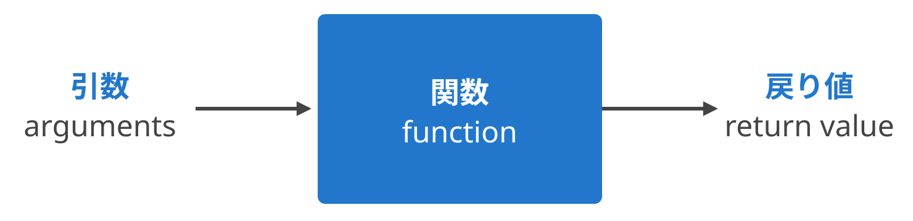
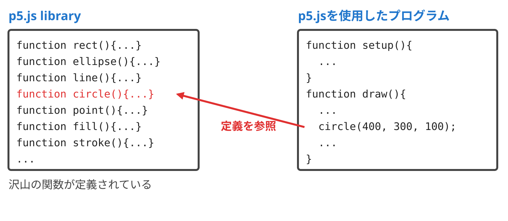
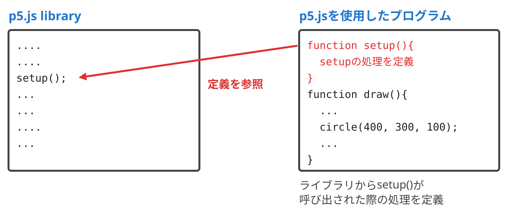
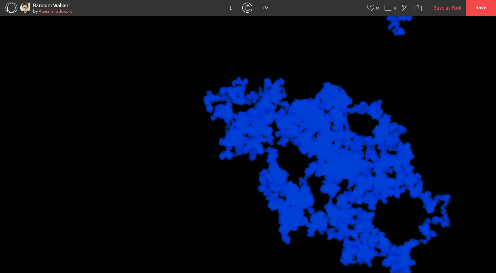
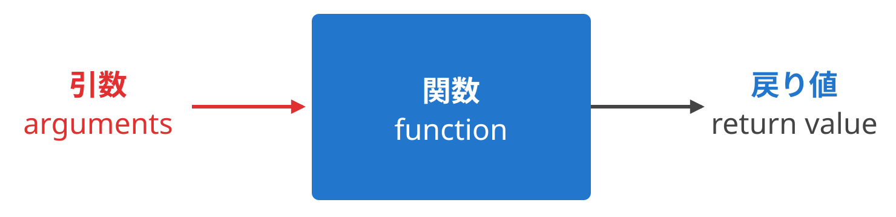
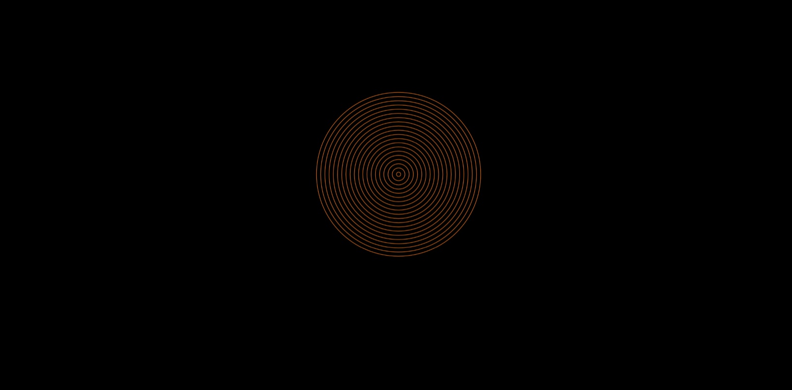
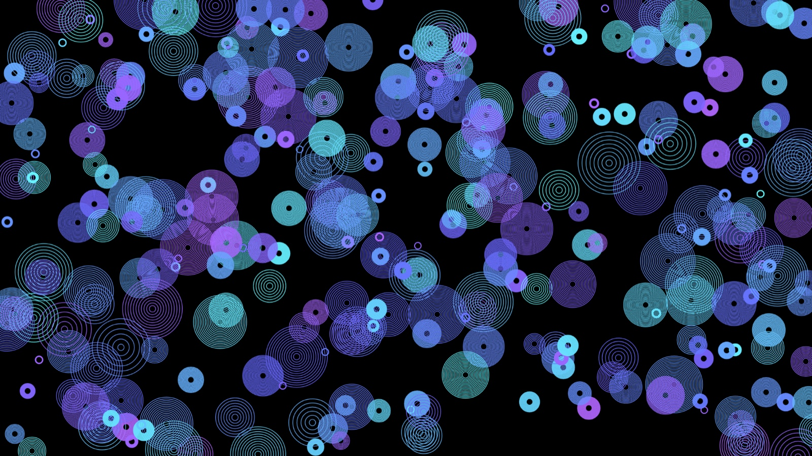
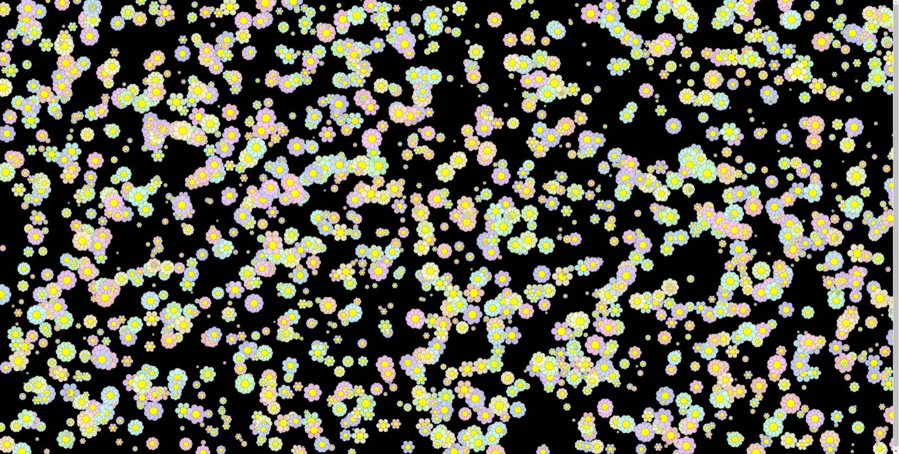

今回は、プログラムの中でまとまった処理をひとつの手続きとして定義する「関数 (function)」について学びます。

まず始めに、関数とは何か、引数と戻り値のしくみを解説します。実は、これまで使ってきた circle() や setup() も関数でした。

次に、ひとつのプログラムをいくつかの関数に分けて整理する「モジュール化」に挑戦します。処理の内容がわかる名前をつけて関数にまとめることで、プログラムが読みやすく、直しやすくなります。

最後に、引数を使って関数にバリエーションをつけます。同心円を描く関数 guruguru() を作り、位置や大きさ、色を変えながら大量に描いてみましょう。

## 本日の課題

テーマ: 「関数 (function) をつかって大量に形を増殖させる」

今回学んだ関数を使って、形を大量に増殖させてみましょう! 引数によってバリエーションをつけながら何か形を描く関数を作成し、作成した関数を draw() 関数から呼び出して大量に形を描いてください。同じ関数でも、引数に渡す位置や大きさ、色、数を変えることで、さまざまなバリエーションが生まれます。次回の授業の冒頭で簡単に作品をいくつか紹介します。

提出方法は以下の通りです。

- 完成した作品には、(かっこいい) タイトルをつける
- 完成した作品はOpenProcessingに投稿してURLを提出
- 必ず TAGS: [sfc261106](https://openprocessing.org/browse?q=sfc261106&time=anytime&type=tags&offset=0) を入れてください
- 前回の[提出作品](https://openprocessing.org/browse?q=sfc261030&time=anytime&type=tags&offset=0)で良いと思った作品を1つ選んでください
- 提出期限 11/12/2026

<!-- 提出フォームのURLを追加 -->
[課題提出フォーム](URL)

## スライド資料

<!-- スライド資料へのリンクを追加 -->
[スライド資料: 関数によるモジュール化とバリエーション](URL)

## 今日の内容

- 関数とは?
- 関数によるモジュール化
- 引数による関数のバリエーション
- 実習

今日のテーマは「関数 (function)」です。関数は、変数 (variable) と対になって、次回のオブジェクト指向プログラミングのキーになります。しっかり理解しましょう。

## 関数とは?

### 関数 (function)

関数 (function) とは、コンピュータプログラミングにおいて、プログラム中で意味や内容がまとまっている作業をひとつの手続きとしたものです。サブルーチン (subroutine) とも呼ばれます。

関数は、値 (引数 : arguments) を元に何らかの計算や処理を行い、結果 (戻り値 : return value) を呼び出し元に返します。



### シンプルな関数の例

指定した数の次の数を計算する関数 nextNum() を作ってみます。function で関数を定義し、return で結果を返します。

```javascript
function setup() {
  //関数の呼び出し
  let num = nextNum(10);
  //結果の出力
  print(num);
}
//指定した数の次の数を計算する関数
function nextNum(n) {
  return n + 1;
}
```

nextNum(10) を呼び出すと、引数 n に 10 が入り、戻り値として 11 が返ってきます。

### 実はずっと関数を使ってきた

実は、ここまでの内容で関数を頻繁に用いてきました! 例えば、circle() は p5.js の関数の呼び出しです。

```javascript
// circle関数の呼び出し
circle(400, 300, 100);
```

また、setup() や draw() は、自分で関数を定義していたのです。

```javascript
// setup関数の定義
function setup() {
  createCanvas(windowWidth, windowHeight);
  frameRate(60);
}
```

p5.js のライブラリには、rect() や ellipse()、circle() など沢山の関数が定義されています。私たちのプログラムで circle() を呼び出すと、ライブラリの中の定義が参照されて円が描かれます。



反対に、setup() や draw() は、ライブラリの方から呼び出されます。私たちのプログラムでは、ライブラリから setup() が呼び出された際の処理を定義しているのです。



## 関数によるモジュール化

### スタートするプログラム

今回は、雲のような模様を描く以下のプログラムからスタートします。OpenProcessing で fork して使用してください。

- [Random Walker](https://www.openprocessing.org/sketch/726079)



このプログラムは、いくつかの手続から構成されています。

- 初期化 : 位置、大きさ (直径)、動く速さを設定
- 円の位置の移動 : ランダムな方向へ動く
- 画面の端に来た際の処理 : 画面の端に来たら反対側から出現
- 円を描く

### 処理を関数に分ける

それぞれの処理を関数にしてみましょう。オリジナルの関数を定義します。関数名は独自に決めてかまいませんが、できるだけ処理の内容がわかる関数名をつけるよう心掛けましょう。例えば、以下のような名前をつけます。

- 初期化 → init()
- 円の位置の移動 → move()
- 画面の端に来た際の処理 → throughWall()
- 円を描く → display()

まずは、draw() の下に関数定義の枠組みを記述します。

```javascript
function init() {
}
function move() {
}
function throughWall() {
}
function display() {
}
```

次に、該当する処理をコピペしてそれぞれの関数の中に移動し、setup() と draw() の該当する場所から関数を呼び出します。完成したプログラムは以下のようになります。

```javascript
let ball = {
  x: 0,
  y: 0,
  diameter: 5,
  speed: 1
};

function setup() {
  createCanvas(windowWidth, windowHeight);
  frameRate(60);
  init();
}

function draw() {
  background(0, 4);
  for (let i = 0; i < ball.speed; i++) {
    move();
    throughWall();
    display();
  }
}

//初期化
function init() {
  ball.x = random(width);
  ball.y = random(height);
  ball.diameter = 10;
  ball.speed = 800;
  background(0);
}

//円の位置の移動
function move() {
  ball.x += random(-1, 1);
  ball.y += random(-1, 1);
}

//画面の端に来た際の処理
function throughWall() {
  if (ball.x > width) {
    ball.x = 0;
  }
  if (ball.x < 0) {
    ball.x = width;
  }
  if (ball.y > height) {
    ball.y = 0;
  }
  if (ball.y < 0) {
    ball.y = height;
  }
}

//円を描く
function display() {
  noStroke();
  fill(31, 127, 255);
  circle(ball.x, ball.y, ball.diameter);
}
```

draw() の中身が、move()、throughWall()、display() という3つの関数の呼び出しだけになり、何をしているのかが一目でわかるようになりました。

## 引数による関数のバリエーション

### 引数

ここまでの関数定義の例では、関数は常に同じ処理をしていました。関数には、引数 (arguments) でパラメータを渡すことができます。引数を使って、関数にバリエーションをつけてみましょう。



### 同心円を描く関数 guruguru()

同心円を描く関数 guruguru() を作ってみます! 想定されるパラメータは以下の4つです。

- 中心位置 (circleLocation) ※p5.Vector
- 同心円の数 (numCircles)
- 大きさ・直径 (diameter)
- 色 (circleColor)

まずは関数を使わずに、そのまま作成してみます。

- [関数を使わないバージョン](https://openprocessing.org/sketch/1564194)

```javascript
function setup() {
  createCanvas(windowWidth, windowHeight);
  frameRate(60);
}
function draw() {
  background(0);
  let circleLocation = createVector(width / 2, height / 2);
  let numCircles = 20;
  let diameter = 400;
  let circleColor = color(255, 127, 31);
  noFill();
  stroke(circleColor);
  for (let i = 0; i < numCircles; i++) {
    let currentDiameter = map(i, 0, numCircles - 1, 10, diameter);
    circle(circleLocation.x, circleLocation.y, currentDiameter);
  }
}
```

circle() の3つめの引数は、円の半径ではなく直径なので、変数名も diameter (直径) としています。map() で、i の値 (0 〜 numCircles - 1) を、円の直径 (10 〜 diameter) に変換しています。i の最大値は numCircles - 1 なので、map() の範囲も numCircles - 1 とすることで、いちばん外側の円の直径がちょうど diameter になります。

同心円が描けました!



### Step 1 : 引数なしの guruguru()

同心円を描いている部分を、そのまま関数 guruguru() として外に出します。

```javascript
function guruguru() {
  let circleLocation = createVector(width / 2, height / 2);
  let numCircles = 20;
  let diameter = 400;
  let circleColor = color(255, 127, 31);
  noFill();
  stroke(circleColor);
  for (let i = 0; i < numCircles; i++) {
    let currentDiameter = map(i, 0, numCircles - 1, 10, diameter);
    circle(circleLocation.x, circleLocation.y, currentDiameter);
  }
}
```

draw() からは、引数無しの guruguru() を呼び出します。

```javascript
function setup() {
  createCanvas(windowWidth, windowHeight);
  frameRate(60);
}
function draw() {
  background(0);
  guruguru();
}
```

### Step 2 : 引数ありの guruguru()

次に、中心位置、同心円の数、大きさ、色を引数として渡せるようにしてみます。関数の中で決めていた値を、引数として受け取るように書き換えます。

```javascript
function guruguru(circleLocation, numCircles, diameter, circleColor) {
  noFill();
  stroke(circleColor);
  for (let i = 0; i < numCircles; i++) {
    let currentDiameter = map(i, 0, numCircles - 1, 10, diameter);
    circle(circleLocation.x, circleLocation.y, currentDiameter);
  }
}
```

引数を指定して、guruguru() 関数を呼び出してみましょう。

```javascript
function setup() {
  createCanvas(windowWidth, windowHeight);
  frameRate(60);
}
function draw() {
  background(0);
  guruguru(createVector(width / 2, height / 2), 20, 400, color(255, 127, 31));
}
```

### いろいろなバリエーション

引数を変えて、いろいろなバリエーションの guruguru を描いてみます!

```javascript
function setup() {
  createCanvas(windowWidth, windowHeight);
  frameRate(60);
}
function draw() {
  background(0);
  guruguru(createVector(600, 300), 20, 400, color(255, 127, 31));
  guruguru(createVector(500, 400), 5, 200, color(0, 255, 127));
  guruguru(createVector(750, 250), 30, 250, color(0, 31, 255));
}
```

### guruguru を大量生成

draw() の中でくりかえし guruguru() 関数を呼び出して、大量に guruguru を生成してみましょう。位置、同心円の数、大きさ、色をランダムに決めて、引数として渡しています。同心円の数は、int() で整数にしています。また、guruguru() の中の map() で numCircles - 1 を使っているので、同心円の数が2以上になるように int(random(2, 11)) としています。

- [guruguruを大量生成](https://openprocessing.org/sketch/2110205)

```javascript
function setup() {
  createCanvas(windowWidth, windowHeight);
  colorMode(HSB, 360, 100, 100, 100);
  background(0);
}
function draw() {
  let x = random(width);
  let y = random(height);
  let h = random(80, 240);
  let s = 80;
  let b = 100;
  let a = 80;
  guruguru(createVector(x, y), int(random(2, 11)), random(width / 20), color(h, s, b, a));
}
function guruguru(circleLocation, numCircles, diameter, circleColor) {
  noFill();
  stroke(circleColor);
  strokeWeight(2.0);
  for (let i = 0; i < numCircles; i++) {
    let currentDiameter = map(i, 0, numCircles - 1, 10, diameter);
    circle(circleLocation.x, circleLocation.y, currentDiameter);
  }
}
```



### 応用 : たくさんの花を描く

ちょっと応用編です。たくさんの花を描いてみましょう。それぞれの花は微妙に違うようにします。花の中心位置、花びらの数、大きさを引数として受け取る関数 flower() を作り、draw() から呼び出します。

- [たくさんの花を描く](https://www.openprocessing.org/sketch/726406)

```javascript
function setup() {
  createCanvas(windowWidth, windowHeight);
  colorMode(HSB, 360, 100, 100, 100);
  background(0);
}
function draw() {
  let center = createVector(random(width), random(height));
  let numPetal = int(random(4, 18));
  let petalSize = random(width / 120, width / 80);
  flower(center, numPetal, petalSize);
}
function flower(center, numPetal, petalSize) {
  stroke(0, 0, 50, 70);
  fill(random(360), 20, 100, 90);
  push();
  translate(center.x, center.y);
  for (let i = 0; i < numPetal; i++) {
    push();
    rotate(2 * PI / numPetal * i);
    circle(petalSize, 0, petalSize);
    pop();
  }
  fill(60, 100, 100);
  circle(0, 0, petalSize * 1.2);
  pop();
}
```



## 関連リンク

- [p5.js Web Editor](https://editor.p5js.org/)
- [p5.js リファレンス](https://p5js.org/reference/)
- [p5.js リファレンス: function](https://p5js.org/reference/p5/function/)
- [p5.js リファレンス: createVector()](https://p5js.org/reference/p5/createVector/)
- [p5.js リファレンス: color()](https://p5js.org/reference/p5/color/)
- [p5.js リファレンス: colorMode()](https://p5js.org/reference/p5/colorMode/)
- [p5.js リファレンス: map()](https://p5js.org/reference/p5/map/)
- [p5.js リファレンス: push()](https://p5js.org/reference/p5/push/)
- [p5.js リファレンス: pop()](https://p5js.org/reference/p5/pop/)
- [p5.js リファレンス: translate()](https://p5js.org/reference/p5/translate/)
- [p5.js リファレンス: rotate()](https://p5js.org/reference/p5/rotate/)
- [OpenProcessing](https://www.openprocessing.org/)

## 本日の課題

テーマ: 「関数 (function) をつかって大量に形を増殖させる」

今回学んだ関数を使って、形を大量に増殖させてみましょう! 引数によってバリエーションをつけながら何か形を描く関数を作成し、作成した関数を draw() 関数から呼び出して大量に形を描いてください。同じ関数でも、引数に渡す位置や大きさ、色、数を変えることで、さまざまなバリエーションが生まれます。次回の授業の冒頭で簡単に作品をいくつか紹介します。

提出方法は以下の通りです。

- 完成した作品には、(かっこいい) タイトルをつける
- 完成した作品はOpenProcessingに投稿してURLを提出
- 必ず TAGS: [sfc261106](https://openprocessing.org/browse?q=sfc261106&time=anytime&type=tags&offset=0) を入れてください
- 前回の[提出作品](https://openprocessing.org/browse?q=sfc261030&time=anytime&type=tags&offset=0)で良いと思った作品を1つ選んでください
- 提出期限 11/12/2026

<!-- 提出フォームのURLを追加 -->
[課題提出フォーム](URL)
