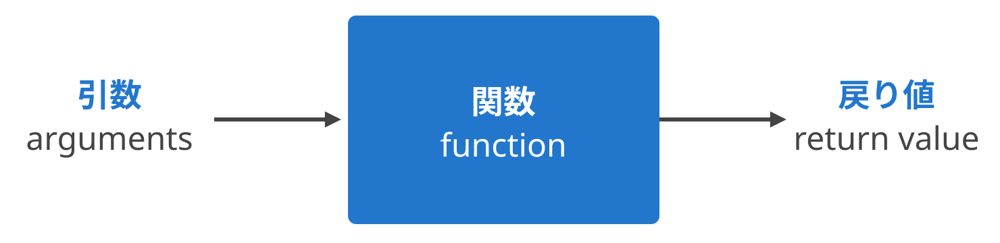
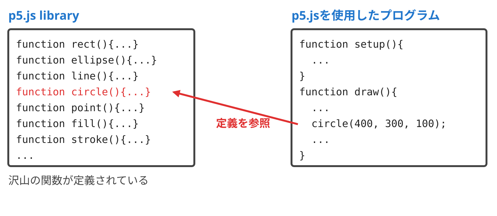
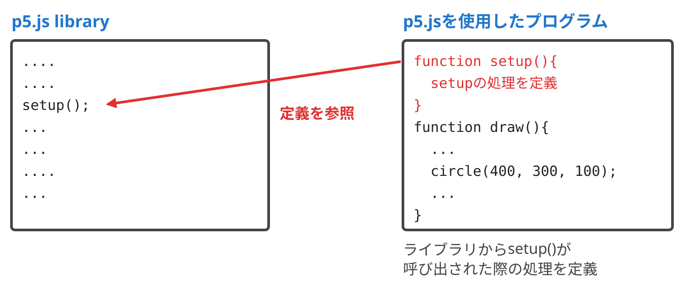
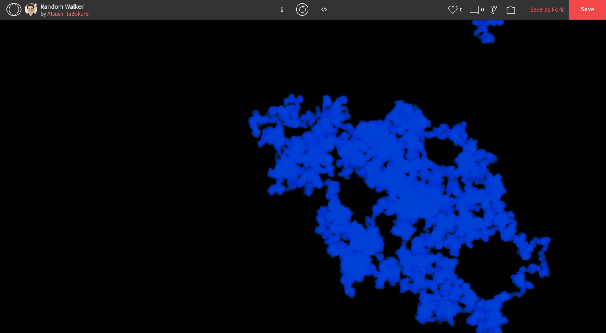
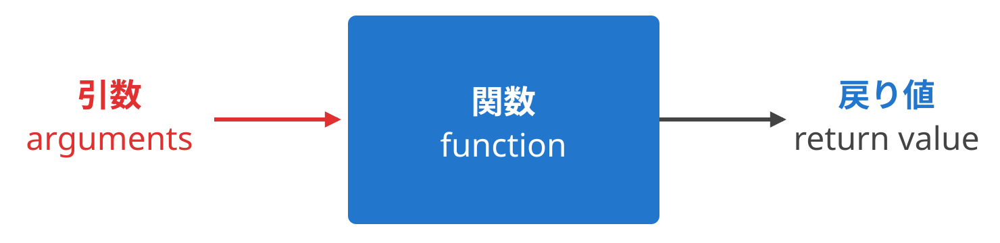
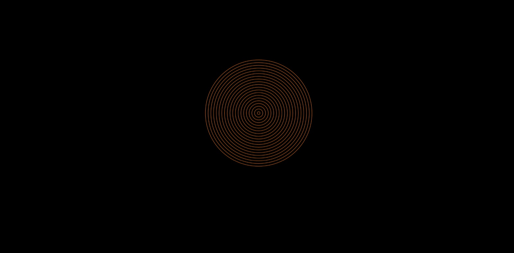
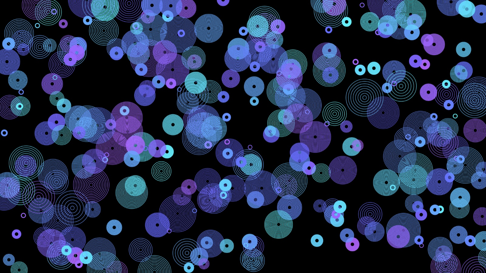
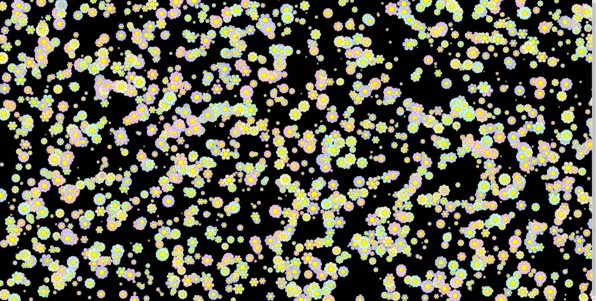

# デザインとプログラミング 2026<br>関数によるモジュール化とバリエーション

慶應義塾大学環境情報学部
田所 淳

---

## 今日の内容

- 今日のテーマ : 関数 (function)
- 変数 (variable) と対になって、次回のオブジェクト指向プログラミングのキーに
- しっかり理解しましょう

---

<!-- _class: bigtxt -->

# 関数とは?

---

## 関数とは?

- 関数 (function)
- コンピュータプログラミングにおいて、プログラム中で意味や内容がまとまっている作業をひとつの手続きとしたもの
- サブルーチン (subroutine)
- 値（引数arguments）を元に何らかの計算や処理を行い結果を呼び出し元に返す



---

## 関数とは?

- シンプルな関数の例: 指定した数の次の数を計算する関数 nextNum()

```javascript
function setup() {
  //関数の呼び出し
  let num = nextNum(10);
  //結果の出力
  print(num);
}
//指定した数の次の数を計算する関数
function nextNum(n) {
  return n + 1;
}
```

---

## 関数とは?

- 実は、ここまでの内容で関数を頻繁に用いてきた!!
- p5.jsの関数の呼び出し

```javascript
// circle関数の呼び出し
circle(400, 300, 100);
```

- p5.jsの関数の定義

```javascript
// setup関数の定義
function setup() {
  createCanvas(windowWidth, windowHeight);
  frameRate(60);
}
```

---

## 関数とは?

- p5.jsの関数の呼び出しのイメージ



---

## 関数とは?

- p5.jsの関数の呼び出しのイメージ



---

<!-- _class: bigtxt -->

# 関数によるモジュール化

---

## 関数によるモジュール化

- 今回はこのプログラムからスタート
- forkして使用する
- [https://www.openprocessing.org/sketch/726079](https://www.openprocessing.org/sketch/726079)

---

## 関数によるモジュール化

- 雲のような模様を描くプログラム



---

## 関数によるモジュール化

- このプログラムはいくつかの手続から構成されている
- 初期化
  - 位置、大きさ (直径)、動く速さを設定
- 円の位置の移動
  - ランダムな方向へ動く
- 画面の端に来た際の処理
  - 画面の端に来たら反対側から出現
- 円を描く

---

## 関数によるモジュール化

- それぞれの処理を関数にしてみる
  - オリジナルの関数を定義する
  - 関数名は独自に決めてよい
  - できるだけ処理の内容がわかる関数名をつけるよう心掛ける
- 例:
  - 初期化 → init();
  - 円の位置の移動 → move();
  - 画面の端に来た際の処理 → throughWall();
  - 円を描く → display();

---

## 関数によるモジュール化

- draw()の下に、まずは関数定義の枠組みを記述

```javascript
function init() {
}
function move() {
}
function throughWall() {
}
function display() {
}
```

---

## 関数によるモジュール化

- 該当する処理をコピペして移動する (1/3)

```javascript
function init() {
  ball.x = random(width);
  ball.y = random(height);
  ball.diameter = 10;
  ball.speed = 800;
  background(0);
}
function move() {
  ball.x += random(-1, 1);
  ball.y += random(-1, 1);
}
```

---

## 関数によるモジュール化

- 該当する処理をコピペして移動する (2/3)

```javascript
function throughWall() {
  if (ball.x > width) {
    ball.x = 0;
  }
  if (ball.x < 0) {
    ball.x = width;
  }
  if (ball.y > height) {
    ball.y = 0;
  }
  if (ball.y < 0) {
    ball.y = height;
  }
}
```

---

## 関数によるモジュール化

- 該当する処理をコピペして移動する (3/3)

```javascript
function display() {
  noStroke();
  fill(31, 127, 255);
  circle(ball.x, ball.y, ball.diameter);
}
```

---

## 関数によるモジュール化

- コピペ後のsetup()とdraw()

```javascript
function setup() {
  createCanvas(windowWidth, windowHeight);
  frameRate(60);
}
function draw() {
  background(0, 4);
  for (let i = 0; i < ball.speed; i++) {

  }
}
```

---

## 関数によるモジュール化

- 該当する場所から、関数を呼び出す

```javascript
function setup() {
  createCanvas(windowWidth, windowHeight);
  frameRate(60);
  init();
}
function draw() {
  background(0, 4);
  for (let i = 0; i < ball.speed; i++) {
    move();
    throughWall();
    display();
  }
}
```

---

<!-- _class: bigtxt -->

# 引数による関数のバリエーション

---

## 引数による関数のバリエーション

- ここまでの関数定義の例では、常に同じ処理をしていた
- 関数には引数 (arguments) でパラメータを渡すことができる
- 引数を使ってバリエーションをつけてみる



---

## 引数による関数のバリエーション

- 同心円を描く関数 guruguru() を作ってみる!
- 想定されるパラメータ
  - 中心位置 (circleLocation) ※p5.Vector
  - 同心円の数 (numCircles)
  - 大きさ・直径 (diameter)
  - 色 (circleColor)
- まずは関数を使わずに、そのまま作成してみる

---

## 引数による関数のバリエーション

- 関数を使わないバージョン [https://openprocessing.org/sketch/1564194](https://openprocessing.org/sketch/1564194)

```javascript
function setup() {
  createCanvas(windowWidth, windowHeight);
  frameRate(60);
}
function draw() {
  background(0);
  let circleLocation = createVector(width / 2, height / 2);
  let numCircles = 20;
  let diameter = 400;
  let circleColor = color(255, 127, 31);
  noFill();
  stroke(circleColor);
  for (let i = 0; i < numCircles; i++) {
    let currentDiameter = map(i, 0, numCircles - 1, 10, diameter);
    circle(circleLocation.x, circleLocation.y, currentDiameter);
  }
}
```

---

## 引数による関数のバリエーション

- 同心円が描けた!



---

## 引数による関数のバリエーション

- circle() の3つめの引数は、半径ではなく直径
  - 変数名も diameter (直径) にしている
- map() で、i の値 (0 〜 numCircles - 1) を直径 (10 〜 diameter) に変換
  - i の最大値は numCircles - 1
  - map() の範囲も numCircles - 1 にすると、いちばん外側の円の直径がちょうど diameter になる

---

## 引数による関数のバリエーション

- Step 1 - 1
- 同心円を描いている部分をそのまま関数 guruguru() として外に出す

---

## 引数による関数のバリエーション

- guruguru() 関数 (引数なし)

```javascript
function guruguru() {
  let circleLocation = createVector(width / 2, height / 2);
  let numCircles = 20;
  let diameter = 400;
  let circleColor = color(255, 127, 31);
  noFill();
  stroke(circleColor);
  for (let i = 0; i < numCircles; i++) {
    let currentDiameter = map(i, 0, numCircles - 1, 10, diameter);
    circle(circleLocation.x, circleLocation.y, currentDiameter);
  }
}
```

---

## 引数による関数のバリエーション

- Step 1 - 2
- 引数無しの guruguru() を呼び出す

---

## 引数による関数のバリエーション

- guruguru() 関数の呼び出し

```javascript
function setup() {
  createCanvas(windowWidth, windowHeight);
  frameRate(60);
}
function draw() {
  background(0);
  guruguru();
}
```

---

## 引数による関数のバリエーション

- Step 2 - 1
- 引数を渡せるようにしてみる
  - 中心位置 (circleLocation) ※p5.Vector
  - 同心円の数 (numCircles)
  - 大きさ・直径 (diameter)
  - 色 (circleColor)

---

## 引数による関数のバリエーション

- guruguru() 関数 (引数あり)

```javascript
function guruguru(circleLocation, numCircles, diameter, circleColor) {
  noFill();
  stroke(circleColor);
  for (let i = 0; i < numCircles; i++) {
    let currentDiameter = map(i, 0, numCircles - 1, 10, diameter);
    circle(circleLocation.x, circleLocation.y, currentDiameter);
  }
}
```

---

## 引数による関数のバリエーション

- Step 2 - 2
- 引数を指定して、guruguru() 関数を呼び出してみる

---

## 引数による関数のバリエーション

- 引数を指定して guruguru() 関数を呼び出し

```javascript
function setup() {
  createCanvas(windowWidth, windowHeight);
  frameRate(60);
}
function draw() {
  background(0);
  guruguru(createVector(width / 2, height / 2), 20, 400, color(255, 127, 31));
}
```

---

## 引数による関数のバリエーション

- いろいろなバリエーションの guruguru を描いてみる!

---

## 引数による関数のバリエーション

- guruguruのバリエーション

```javascript
function setup() {
  createCanvas(windowWidth, windowHeight);
  frameRate(60);
}
function draw() {
  background(0);
  guruguru(createVector(600, 300), 20, 400, color(255, 127, 31));
  guruguru(createVector(500, 400), 5, 200, color(0, 255, 127));
  guruguru(createVector(750, 250), 30, 250, color(0, 31, 255));
}
```

---

## 引数による関数のバリエーション

- 大量に guruguru を生成
- draw()の中でくりかえしguruguru()関数を呼び出してみる!

---

## 引数による関数のバリエーション

- guruguruを大量生成! [https://openprocessing.org/sketch/2110205](https://openprocessing.org/sketch/2110205)

```javascript
function setup() {
  createCanvas(windowWidth, windowHeight);
  colorMode(HSB, 360, 100, 100, 100);
  background(0);
}
function draw() {
  let x = random(width);
  let y = random(height);
  let h = random(80, 240);
  let s = 80;
  let b = 100;
  let a = 80;
  guruguru(createVector(x, y), int(random(2, 11)), random(width / 20), color(h, s, b, a));
}
```

---

## 引数による関数のバリエーション

- guruguruを大量生成! (guruguru() 関数)

```javascript
function guruguru(circleLocation, numCircles, diameter, circleColor) {
  noFill();
  stroke(circleColor);
  strokeWeight(2.0);
  for (let i = 0; i < numCircles; i++) {
    let currentDiameter = map(i, 0, numCircles - 1, 10, diameter);
    circle(circleLocation.x, circleLocation.y, currentDiameter);
  }
}
```

---

## 引数による関数のバリエーション

- 完成したguruguruバリエーションの例



---

## 引数による関数のバリエーション

- ちょっと応用編
- たくさんの花を描いてみる
- それぞれの花は微妙に違うように

---

## 引数による関数のバリエーション

- たくさんの花を描いてみる – 解答例 (setup() と draw())

```javascript
function setup() {
  createCanvas(windowWidth, windowHeight);
  colorMode(HSB, 360, 100, 100, 100);
  background(0);
}
function draw() {
  let center = createVector(random(width), random(height));
  let numPetal = int(random(4, 18));
  let petalSize = random(width / 120, width / 80);
  flower(center, numPetal, petalSize);
}
```

---

## 引数による関数のバリエーション

- たくさんの花を描いてみる – 解答例 (flower() 関数)

```javascript
function flower(center, numPetal, petalSize) {
  stroke(0, 0, 50, 70);
  fill(random(360), 20, 100, 90);
  push();
  translate(center.x, center.y);
  for (let i = 0; i < numPetal; i++) {
    push();
    rotate(2 * PI / numPetal * i);
    circle(petalSize, 0, petalSize);
    pop();
  }
  fill(60, 100, 100);
  circle(0, 0, petalSize * 1.2);
  pop();
}
```

---

## 引数による関数のバリエーション

- たくさんの花を描いてみる – 完成!!
- [https://www.openprocessing.org/sketch/726406](https://www.openprocessing.org/sketch/726406)



---

<!-- _class: bigtxt -->

# 本日の課題

---

## 本日の課題

- テーマ: 「関数 (function) をつかって大量に形を増殖させる」
- 引数によってバリエーションをつけながら、何か形を描く関数を作成する!
  - 作成した関数を draw() 関数から呼び出して、大量に形を描く
- OpenProcessingにタイトルをつけて投稿してください!
  - 作品の(かっこいい)タイトルをつけてください!!
  - 投稿したURLをアンケートから提出
  - TAGS: sfc261106 を必ずつけること
  - 前回の[提出作品](https://openprocessing.org/browse?q=sfc261030&time=anytime&type=tags&offset=0)で良いと思った作品を1つ選んでください
