今回は、プログラムを「オブジェクト」という機能の単位で組み立てる「オブジェクト指向プログラミング (OOP)」の入門です。

まず始めに、次に現れる位置がランダムに決まる「ランダムウォーク」の動きを作ります。点がランダムに動きまわることで、雲のような複雑な模様が描かれます。

次に、このランダムに動く点をたくさん表示するにはどうすれば良いかを考えながら、オブジェクト、プロパティー、メソッド、そしてオブジェクトの設計図である「クラス」について解説します。

最後に、ランダムウォークする動きを Walker クラスにまとめ、オブジェクトの配列を使って10個、100個と増殖させてみましょう。

## 本日の課題

テーマ: 「クラスを用いてOOPな生成的な作品を制作する」

今回学んだクラスを使って、生成的な作品を制作してみましょう! 今回の講義内で作成した、増殖するランダムウォークのプログラムを参考に、オブジェクトを大量に複製することで生成的な作品を制作してください。クラスの中の動きや描きかたを変えるだけで、増殖したオブジェクト全体の表情が大きく変わります。次回の授業の冒頭で簡単に作品をいくつか紹介します。

提出方法は以下の通りです。

- 完成した作品には、(かっこいい) タイトルをつける
- 完成した作品はOpenProcessingに投稿してURLを提出
- 必ず TAGS: [sfc261113](https://openprocessing.org/browse?q=sfc261113&time=anytime&type=tags&offset=0) を入れてください
- 前回の[提出作品](https://openprocessing.org/browse?q=sfc261106&time=anytime&type=tags&offset=0)で良いと思った作品を1つ選んでください
- 提出期限 11/19/2026

<!-- 提出フォームのURLを追加 -->
[課題提出フォーム](URL)

## スライド資料

<!-- スライド資料へのリンクを追加 -->
[スライド資料: p5.js オブジェクト指向プログラミング入門](URL)

## 今日の内容

- 生成的な形をつくる - ランダムウォーク
- ランダムウォークを増殖 - プログラムを構造化する
- クラスを作る
- 参考資料: 生成的な形態を作る
- 実習

## 生成的な形をつくる - ランダムウォーク

### ランダムウォーク

ランダムウォークの動きをつくってみましょう! ランダムウォークとは、次に現れる位置が確率的にランダムに決定される運動です。今いる位置から、上下左右のどの方向に進むかが毎回ランダムに決まります。

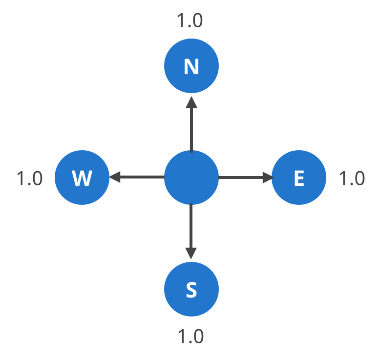

### 本日の基本プログラム

ランダムウォークのプログラムは以下のようになります。位置 (position) と速度 (velocity) をベクトル (p5.Vector) で扱い、draw() が実行されるたびに上下左右ランダムな速度を位置に足していきます。for文で10回くりかえすことで、10倍速で動かしています。

- [ランダムウォーク (ベクトル版)](https://openprocessing.org/sketch/611320)

```javascript
let position;
let velocity;

function setup() {
  //初期設定
  createCanvas(windowWidth, windowHeight);
  frameRate(60);
  //初期位置を画面の中心に
  position = createVector(width / 2, height / 2);
  //軌跡を残す
  background(0);
}

function draw() {
  //10倍速で
  for (let i = 0; i < 10; i++) {
    //上下左右にランダムな速度
    velocity = createVector(random(-1, 1), random(-1, 1));
    //位置を更新
    position.add(velocity);
    //円を描画
    noStroke();
    fill(0, 127, 255, 31);
    ellipse(position.x, position.y, 2, 2);
  }
}
```

background() を setup() で1回だけ実行しているので、軌跡が残り、雲のような複雑な模様が描かれるようになります。

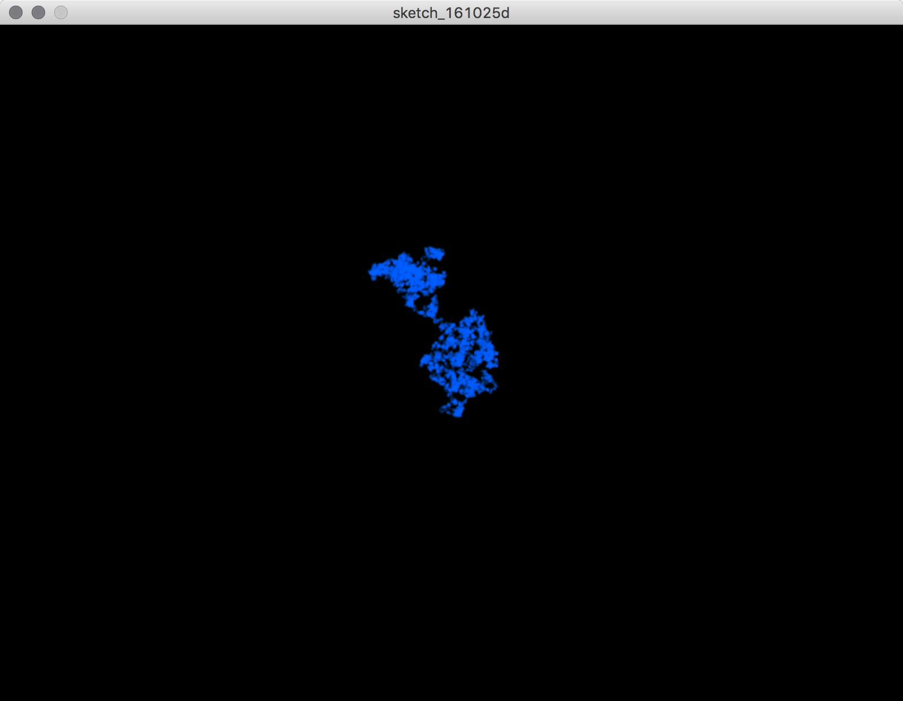

## ランダムウォークを増殖 - プログラムを構造化する

### たくさん表示するには?

このランダムに移動する点を、いちどに沢山表示してみたいと思います。どうすれば良いでしょうか?

方法1は、位置をたくさん記憶する方法です。p5.Vector で記憶した変数「position」を大量に用意したいので、配列にします。

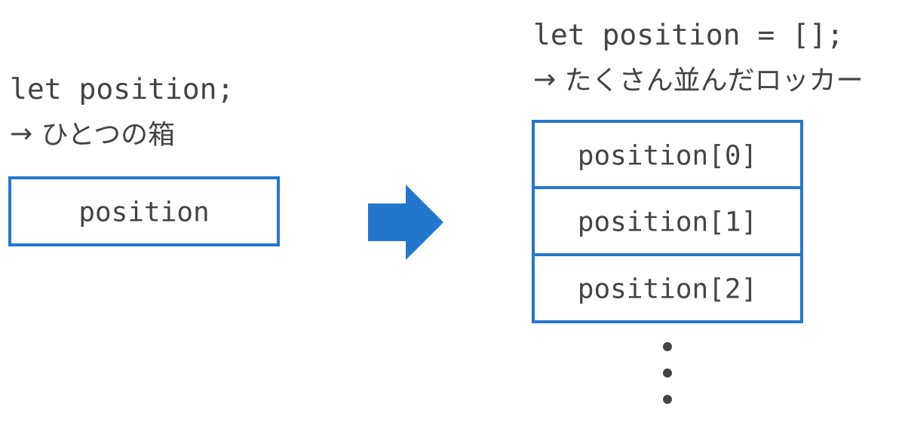

もう1つ別の方法は、ランダムに移動する点自体を、大量に生成する方法です。「ランダムな場所を決めて、移動して、軌跡を描く」という機能のまとまりを、大量に生成します。今回はこの方法を採用します。

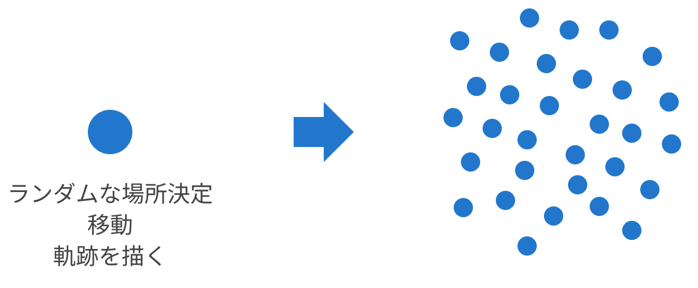

### オブジェクト

実は、この「機能の単位」を独立させるという発想は、プログラムの構造化の重要なコンセプトの一つです。プログラムの中の独立した機能の単位を「オブジェクト (Object)」と呼びます。

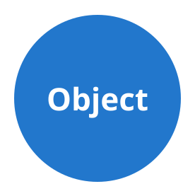

オブジェクトは、それぞれ自律していて、相互にメッセージを送りあいます。

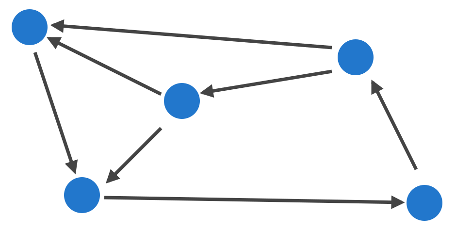

こうした、オブジェクトをプログラムの構成単位とするプログラム手法を、オブジェクト指向プログラミング (Object Oriented Programming : OOP) と呼びます。

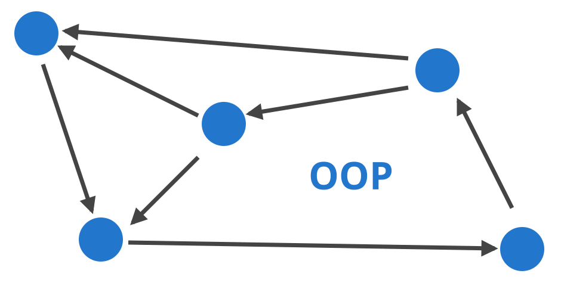

### プロパティーとメソッド

OOPを構成する単位「Object」に注目してみましょう。Objectは、「状態 (プロパティー)」と「動作 (メソッド)」で特徴を記録します。

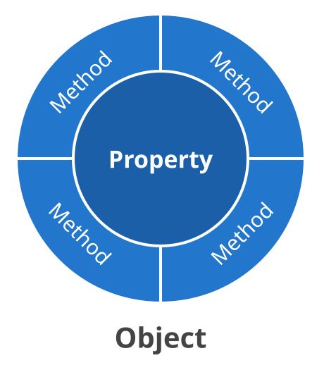

- 状態 → 値を記録する = 変数 (Variables)
- 動作 → 一連の処理をまとめる = 関数 (Functions)

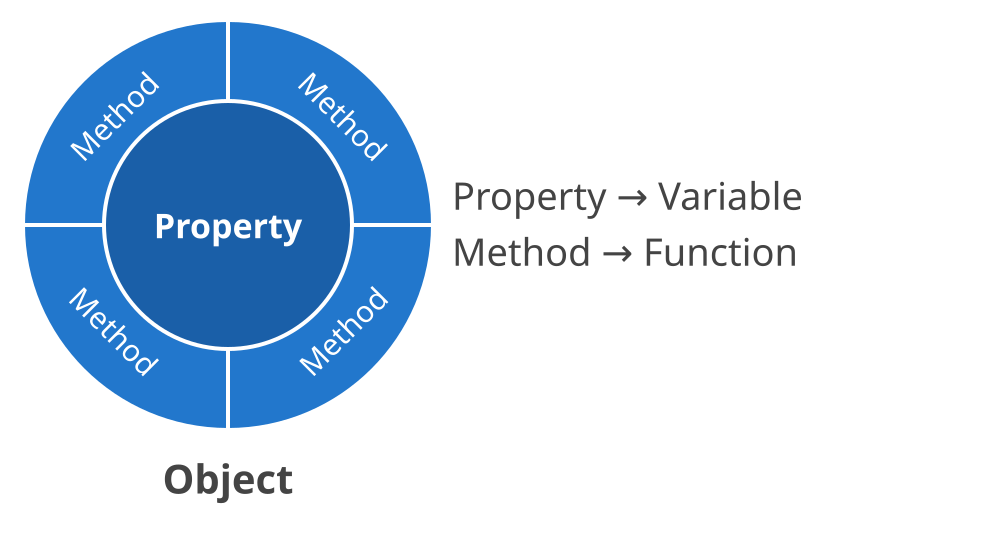

例えば、ランダムに動く点で考えると、以下のようになります。

- 状態 (変数) → 点の位置 (position)
- 動作 (関数) → 初期設定 (constructor())、描画 (draw())

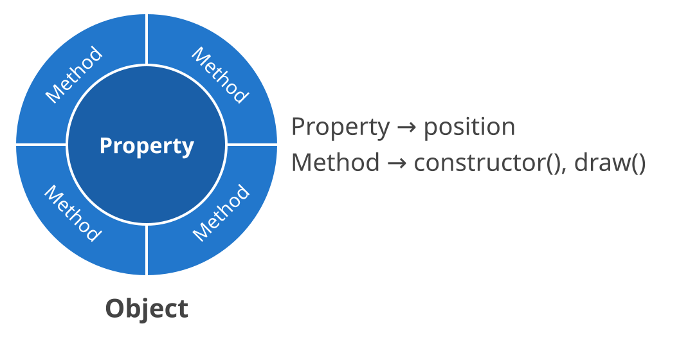

### クラス

OOPでは、オブジェクトの設計図をまず書きます。オブジェクトの設計図のことを「クラス (Class)」と呼びます。1つのクラスから、同じ特徴を持ったオブジェクトをいくつでも作ることができます。

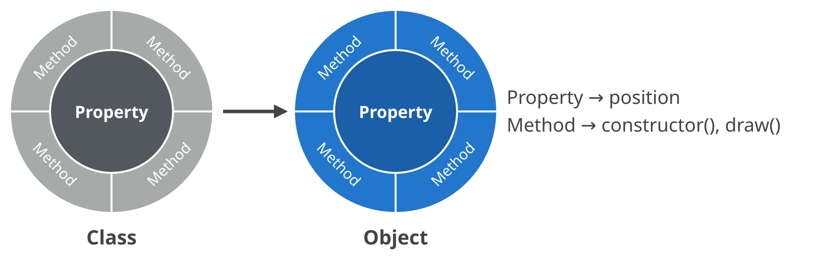

## クラスを作る

### クラスの基本構造

ランダムウォークする動きをクラス化してみましょう。クラス名は Walker にします。p5.js (JavaScript) のクラスの基本構造は以下のようになります。

```javascript
class MyClass {
  //コンストラクター
  constructor() {
    ...
  }
  //関数を宣言
  myFunction() {
    ...
  }
  ...
}
```

### コンストラクター

コンストラクター (constructor) とは、クラスが初期化される際に呼びだされる特別な関数です。関数名は constructor() です。

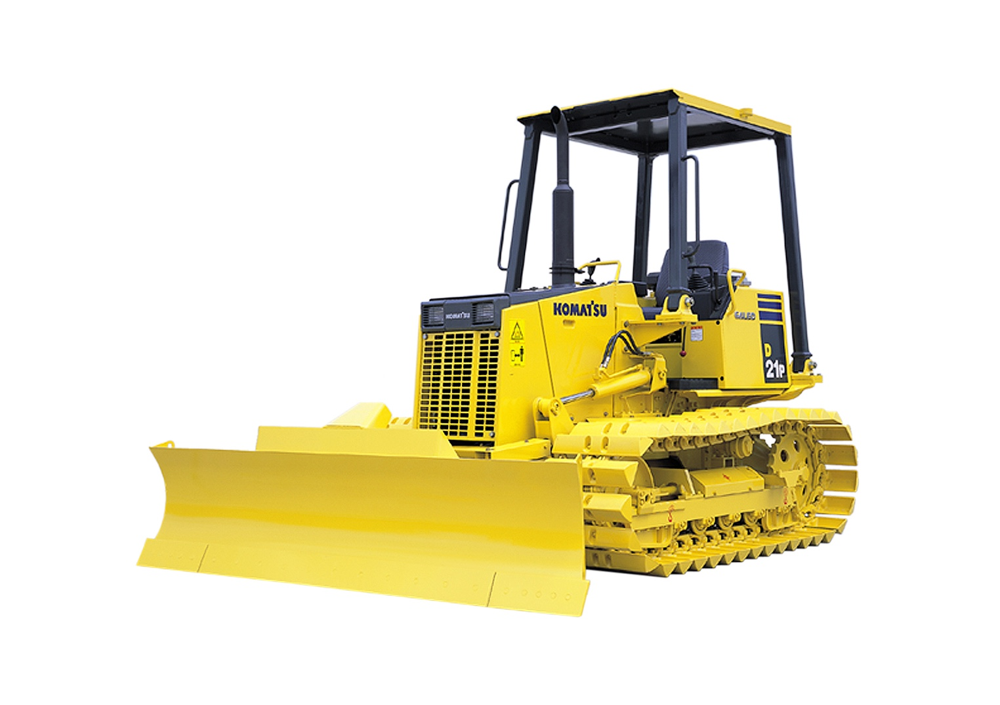

Walker クラスにコンストラクターを実装します。クラスの中の変数 (プロパティー) は、this をつけて this.position のように書きます。

```javascript
//Walkerクラス
class Walker {
  constructor() {
    //初期位置を画面の中心に
    this.position = createVector(width / 2, height / 2);
  }
}
```

### draw() を追加

次に、Walker を描画する draw() を追加します。ランダムウォークする動きをそのまま移植して、Walker クラスの中に draw() 関数として実装します。

```javascript
//Walkerクラス
class Walker {
  constructor() {
    //初期位置を画面の中心に
    this.position = createVector(width / 2, height / 2);
  }

  draw() {
    //10倍速で
    for (let i = 0; i < 10; i++) {
      //上下左右にランダムな速度
      this.velocity = createVector(random(-1, 1), random(-1, 1));
      //位置を更新
      this.position.add(this.velocity);
      //円を描画
      noStroke();
      fill(0, 127, 255, 31);
      ellipse(this.position.x, this.position.y, 2, 2);
    }
  }
}
```

### Walker クラスを呼び出す

このままではまだ動きません。p5.js のメインの描画の構造 (setup() と draw()) から呼び出す必要があります。new Walker() で Walker クラスからオブジェクトを作り (インスタンス化)、draw() の中から walker.draw() を実行します。以下のコードの下に、上の Walker クラスを書いてください。

- [Walkerクラスを呼び出す](https://openprocessing.org/sketch/611324)

```javascript
//Walkerクラスのオブジェクトwalker
let walker;

function setup() {
  //初期設定
  createCanvas(windowWidth, windowHeight);
  //Walkerクラスをインスタンス化
  walker = new Walker();
  //軌跡を残す
  background(0);
}

function draw() {
  //Walkerクラスのdraw()を実行
  walker.draw();
}
```

Walker クラスを描画できました!


### Walker を増殖させる

walker オブジェクトを増殖させてみましょう。オブジェクトの配列をつくれば OK です!

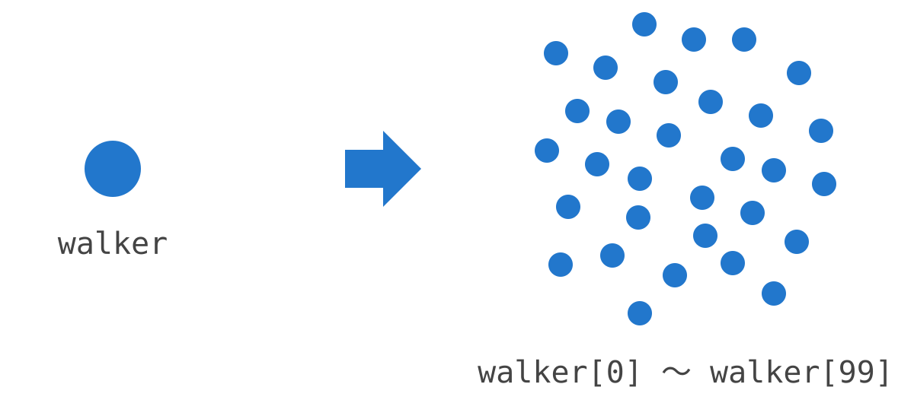

Walker クラスはそのままで、setup() と draw() を以下のように書き換えます。

- [10個に増殖したランダムウォーク](https://openprocessing.org/sketch/611325)

```javascript
const num = 10;
let walker = [];

function setup() {
  //初期設定
  createCanvas(windowWidth, windowHeight);
  //Walkerクラスをインスタンス化
  for (let i = 0; i < num; i++) {
    walker[i] = new Walker();
  }
  //軌跡を残す
  background(0);
}

function draw() {
  //Walkerクラスのdraw()を実行
  for (let i = 0; i < num; i++) {
    walker[i].draw();
  }
}
```

10個に増殖したランダムウォーク!!

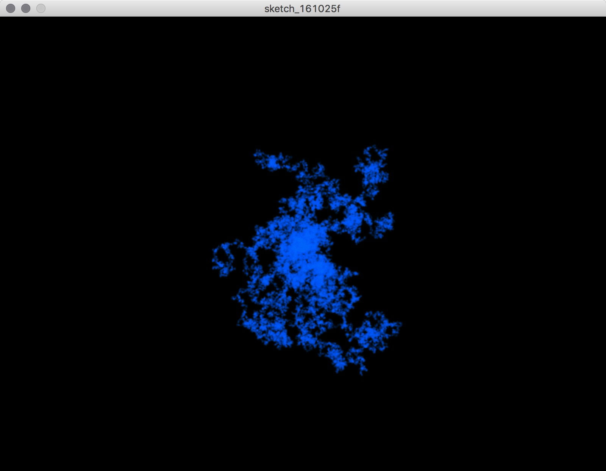

### 100個の Walker

基本の構造さえつくってしまえば、Walker はいくらでも増やせます!! 10個から100個に増やしてみましょう。画面を少しずつフェードさせ、Walker の色は blendMode(ADD) で加算して重ねています。

- [大量のランダムウォーカー](https://openprocessing.org/sketch/611326)

```javascript
const num = 100;
let walker = [];

function setup() {
  //初期設定
  createCanvas(windowWidth, windowHeight);
  //Walkerクラスをインスタンス化
  for (let i = 0; i < num; i++) {
    walker[i] = new Walker();
  }
  background(0);
}

function draw() {
  //画面をフェード
  blendMode(BLEND);
  fill(0, 5);
  rect(0, 0, width, height);
  //Walkerクラスのdraw()を実行 (色を加算して重ねる)
  blendMode(ADD);
  for (let i = 0; i < num; i++) {
    walker[i].draw();
  }
}
```

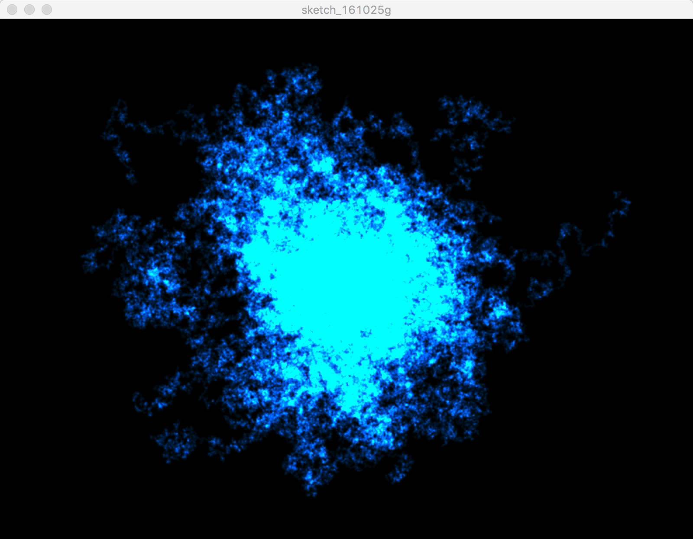

## 参考資料: 生成的な形態を作る

### 生成的 (Generative)

生成的 (Generative) とは、数学的、機械的、あるいは無作為な過程によって自律的に生成されることです。今回のランダムウォークのように、ルールを決めて自律的に形を生成する表現は、これまで多くの作家によって探求されてきました。

### 生成的な表現を利用した作品例

**Gallery of Computation, Jared Tarbell**

- [http://www.complexification.net/gallery/](http://www.complexification.net/gallery/)

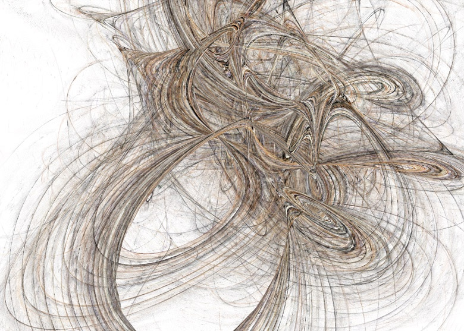

**Ambushes, Eno Henze**

- [http://www.enohenze.de/](http://www.enohenze.de/)

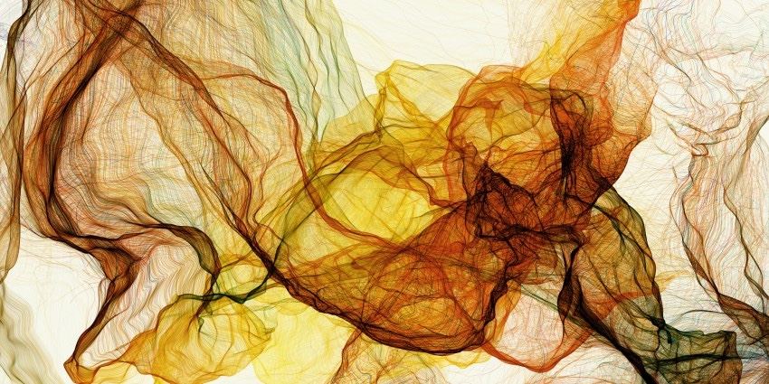

**Segmentation and Symptom, Golan Levin**

- [http://www.flong.com/projects/zoo/](http://www.flong.com/projects/zoo/)

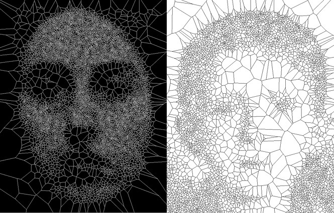

**Superformula, David Dessens**

- [http://www.sanchtv.com/](http://www.sanchtv.com/)

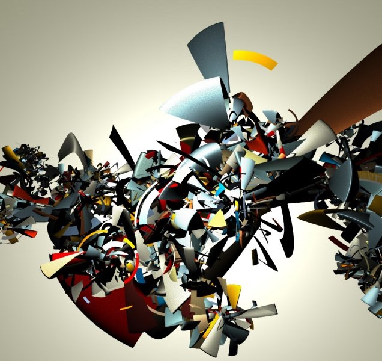

**Arcs 21, Lia**

- [http://liaworks.com/projects/arcs21/](http://liaworks.com/projects/arcs21/)


**Process 1 - Process 18, Casey Reas**

- [http://reas.com/texts/processdrawing-ad.html](http://reas.com/texts/processdrawing-ad.html)
- [http://vimeo.com/22955812](http://vimeo.com/22955812)

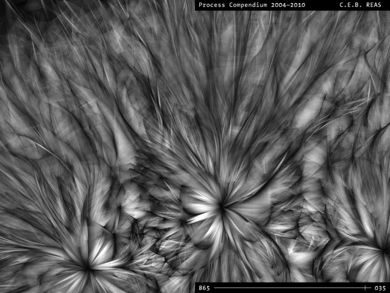

Casey Reas の “Process” シリーズは、以下のような形 (Forms) と振る舞い (Behaviors) のルールの組み合わせから生成されています ([http://reas.com/compendium_text/](http://reas.com/compendium_text/))。

- Forms
  - F1: Circle
  - F2: Line
- Behaviors
  - B1: Move in a straight line
  - B2: Constrain to surface
  - B3: Change direction while touching another Element
  - B4: Move away from an overlapping Element
  - B5: Enter from the opposite edge after moving off the surface
  - B6: Orient toward the direction of an Element that is touching
  - B7: Deviate from the current direction
- Elements
  - E1: F1 + B1 + B2 + B3 + B4
  - E2: F1 + B1 + B5
  - E3: F2 + B1 + B3 + B5
  - E4: F1 + B1 + B2 + B3
  - E5: F2 + B1 + B5 + B6 + B7

### 生成的な表現をとりあつかった書籍

**Generative Gestaltung**

- Hartmut Bohnacker, Benedikt Gross, Julia Laub, Claudius Lazzeroni (編集)
- [http://www.amazon.co.jp/dp/3874397599/](http://www.amazon.co.jp/dp/3874397599/)

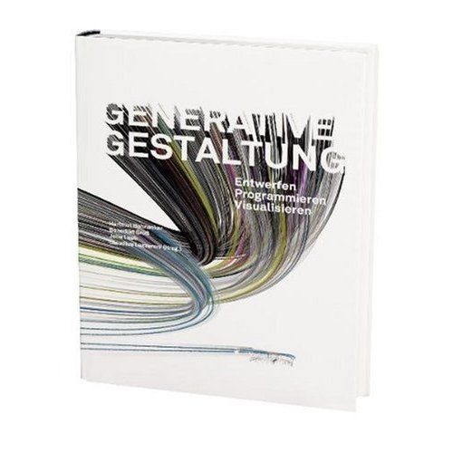

**FORM+CODE -デザイン／アート／建築における、かたちとコード**

- 久保田 晃弘 (監修), 吉村 マサテル (翻訳)
- [http://www.amazon.co.jp/dp/4861007518/](http://www.amazon.co.jp/dp/4861007518/)

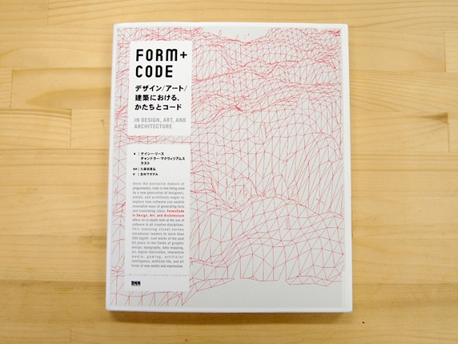

**Generative Art: A Practical Guide Using Processing**

- Matt Pearson (著)
- [http://www.amazon.co.jp/dp/1935182625/](http://www.amazon.co.jp/dp/1935182625/)

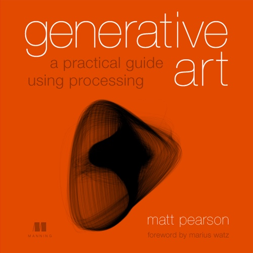

**Visual Complexity: Mapping Patterns of Information**

- Manuel Lima (著)
- [http://www.amazon.co.jp/dp/1568989369/](http://www.amazon.co.jp/dp/1568989369/)

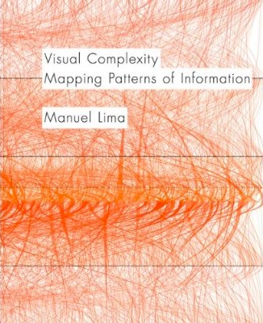

**Written Images**

- [http://writtenimages.net/](http://writtenimages.net/)


## 関連リンク

- [p5.js Web Editor](https://editor.p5js.org/)
- [p5.js リファレンス](https://p5js.org/reference/)
- [p5.js リファレンス: class](https://p5js.org/reference/p5/class/)
- [p5.js リファレンス: createVector()](https://p5js.org/reference/p5/createVector/)
- [p5.js リファレンス: p5.Vector](https://p5js.org/reference/p5/p5.Vector/)
- [p5.js リファレンス: random()](https://p5js.org/reference/p5/random/)
- [p5.js リファレンス: Array](https://p5js.org/reference/p5/Array/)
- [p5.js リファレンス: blendMode()](https://p5js.org/reference/p5/blendMode/)
- [MDN: クラス (JavaScript)](https://developer.mozilla.org/ja/docs/Web/JavaScript/Reference/Classes)
- [OpenProcessing](https://www.openprocessing.org/)

## 本日の課題

テーマ: 「クラスを用いてOOPな生成的な作品を制作する」

今回学んだクラスを使って、生成的な作品を制作してみましょう! 今回の講義内で作成した、増殖するランダムウォークのプログラムを参考に、オブジェクトを大量に複製することで生成的な作品を制作してください。クラスの中の動きや描きかたを変えるだけで、増殖したオブジェクト全体の表情が大きく変わります。次回の授業の冒頭で簡単に作品をいくつか紹介します。

提出方法は以下の通りです。

- 完成した作品には、(かっこいい) タイトルをつける
- 完成した作品はOpenProcessingに投稿してURLを提出
- 必ず TAGS: [sfc261113](https://openprocessing.org/browse?q=sfc261113&time=anytime&type=tags&offset=0) を入れてください
- 前回の[提出作品](https://openprocessing.org/browse?q=sfc261106&time=anytime&type=tags&offset=0)で良いと思った作品を1つ選んでください
- 提出期限 11/19/2026

<!-- 提出フォームのURLを追加 -->
[課題提出フォーム](URL)
