# デザインとプログラミング 2026<br>p5.js オブジェクト指向プログラミング入門

慶應義塾大学環境情報学部
田所 淳

---

<!-- _class: bigtxt -->

# 生成的な形をつくる - ランダムウォーク

---

## ランダムウォーク

- ランダムウォークの動きをつくってみよう!
- ランダムウォーク : 次に現れる位置が確率的にランダムに決定される運動

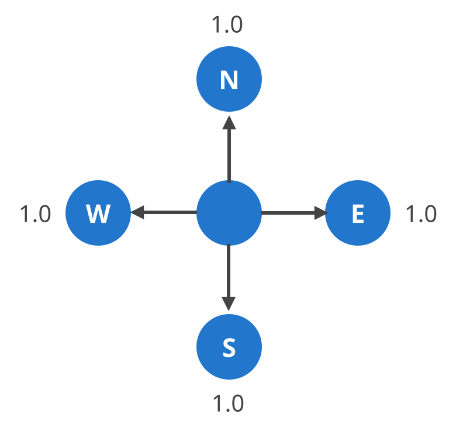

---

## ランダムウォーク

- 本日の基本プログラム: ランダムウォーク (ベクトル版) → [Link](https://openprocessing.org/sketch/611320)

```javascript
let position;
let velocity;
function setup() {
  //初期設定
  createCanvas(windowWidth, windowHeight);
  frameRate(60);
  //初期位置を画面の中心に
  position = createVector(width / 2, height / 2);
  //軌跡を残す
  background(0);
}
```

---

## ランダムウォーク

- 本日の基本プログラム: ランダムウォーク (ベクトル版) - draw()

```javascript
function draw() {
  //10倍速で
  for (let i = 0; i < 10; i++) {
    //上下左右にランダムな速度
    velocity = createVector(random(-1, 1), random(-1, 1));
    //位置を更新
    position.add(velocity);
    //円を描画
    noStroke();
    fill(0, 127, 255, 31);
    ellipse(position.x, position.y, 2, 2);
  }
}
```

---

## ランダムウォーク

- 雲のような複雑な模様が描かれるようになった

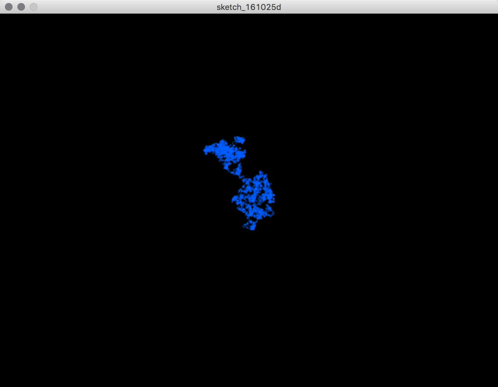

---

<!-- _class: bigtxt -->

# ランダムウォークを増殖<br>プログラムを構造化する

---

## プログラムを構造化する

- このランダムに移動する点を、いちどに沢山表示してみたい
- どうすれば良いか?

---

## プログラムを構造化する

- 方法1: 位置をたくさん記憶する
- p5.Vector で記憶した変数「position」を大量に用意したい → 配列にする

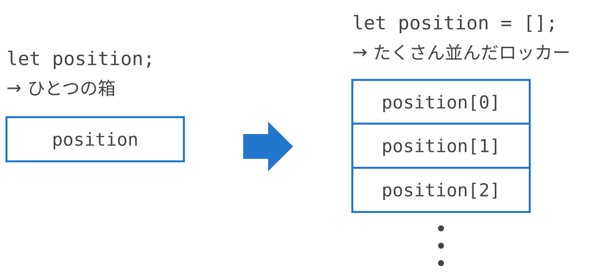

---

## プログラムを構造化する

- もう1つ別の方法 : ランダムに移動する点自体を、大量に生成する
- 「ランダムな場所を決めて、移動して、軌跡を描く」という機能を大量生成
- 今回はこの方法を採用

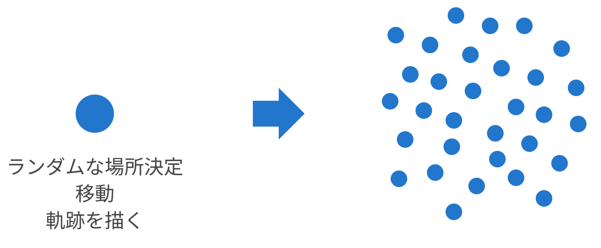

---

## プログラムを構造化する

- 実は、この「機能の単位」を独立させるという発想は、プログラムの構造化の重要なコンセプトの一つ
- プログラムの中の独立した機能の単位 → 「オブジェクト（Object）」と呼ぶ

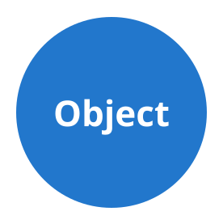

---

## プログラムを構造化する

- オブジェクトは、それぞれ自律していて、相互にメッセージを送りあう

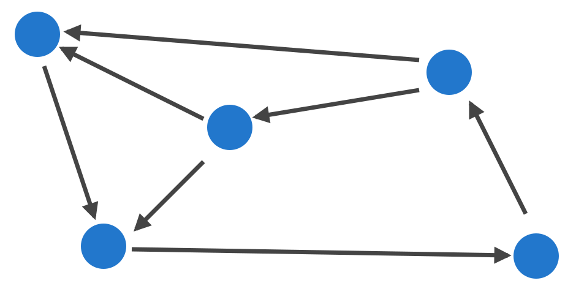

---

## プログラムを構造化する

- こうした、オブジェクトをプログラムの構成単位とするプログラム手法
- → オブジェクト指向プログラミング（Object Oriented Programming）と呼ぶ

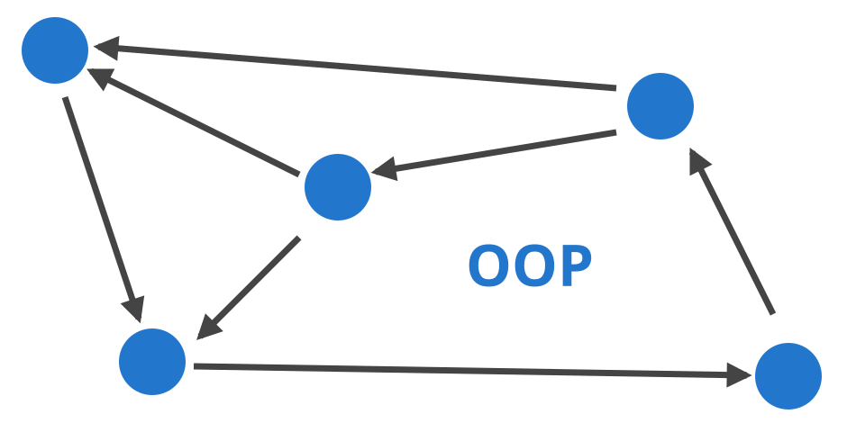

---

## プログラムを構造化する

- OOPを構成する単位「Object」に注目
- Objectは、「状態（プロパティー）」と「動作（メソッド）」で特徴を記録する

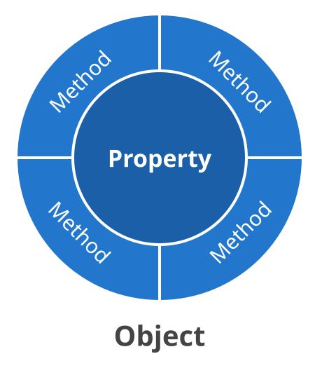

---

## プログラムを構造化する

- 状態 → 値を記録する = 変数（Variables）
- 動作 → 一連の処理をまとめる = 関数（Functions）

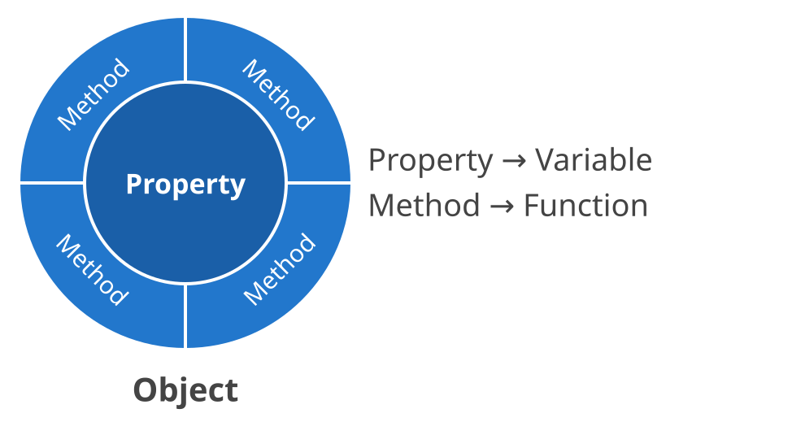

---

## プログラムを構造化する

- 例えば、ランダムに動く点で考えると
- 状態（変数） → 点の位置
- 動作（関数） → 初期設定、描画

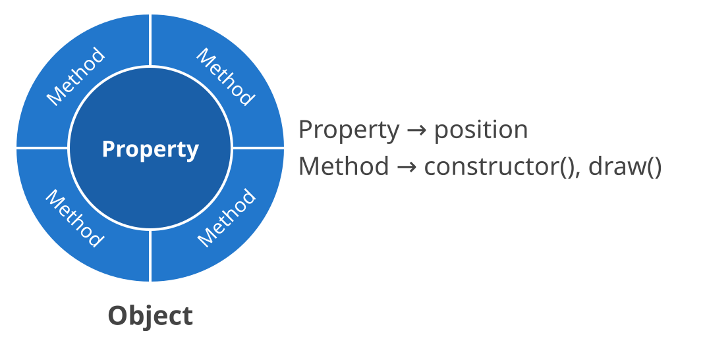

---

## プログラムを構造化する

- OOPでは、オブジェクトの設計図をまず書く
- オブジェクトの設計図のことをクラス（Class）と呼ぶ

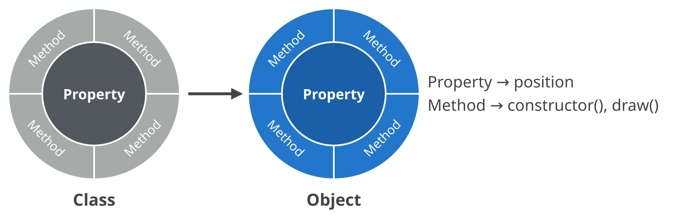

---

<!-- _class: bigtxt -->

# クラスを作る

---

## クラスを作る

- ランダムウォークする動きをクラス化してみる
- クラス名は、Walkerで

---

## クラスを作る

- p5.js (JavaScript) のクラスの基本構造

```javascript
class MyClass {
  //コンストラクター
  constructor() {
    ...
  }
  //関数を宣言
  myFunction() {
    ...
  }
  ...
}
```

---

## クラスを作る

- コンストラクター（constructor）とは?
- クラスが初期化される際に呼びだされる特別な関数
- 関数名は、constructor()

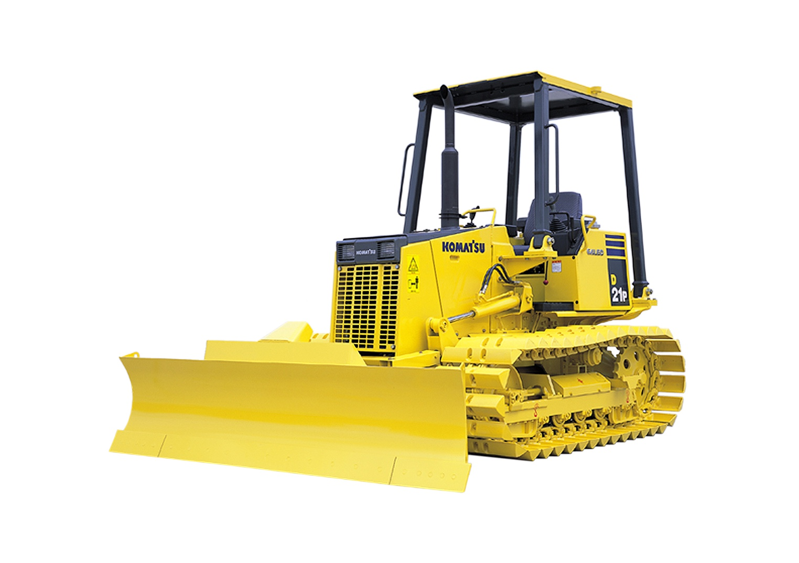

---

## クラスを作る

- コンストラクターを実装

```javascript
//Walkerクラス
class Walker {
  constructor() {
    //初期位置を画面の中心に
    this.position = createVector(width / 2, height / 2);
  }
}
```

---

## クラスを作る

- Walkerを描画する
  - ランダムウォークする動きをそのまま移植
  - Walkerクラスの中に、draw() 関数として実装

---

## クラスを作る

- draw() を追加 (1/2)

```javascript
class Walker {
  constructor() {
    //初期位置を画面の中心に
    this.position = createVector(width / 2, height / 2);
  }
  draw() {
    //10倍速で
    for (let i = 0; i < 10; i++) {
      //上下左右にランダムな速度
      this.velocity = createVector(random(-1, 1), random(-1, 1));
      //位置を更新
      this.position.add(this.velocity);
```

---

## クラスを作る

- draw() を追加 (2/2)

```javascript
      //円を描画
      noStroke();
      fill(0, 127, 255, 31);
      ellipse(this.position.x, this.position.y, 2, 2);
    }
  }
}
```

---

## クラスを作る

- このままではまだ動かない
- p5.jsのメインの描画の構造から呼び出す必要がある

---

## クラスを作る

- Walkerクラスを呼び出す → [Link](https://openprocessing.org/sketch/611324)

```javascript
//Walkerクラスのオブジェクトwalker
let walker;
function setup() {
  //初期設定
  createCanvas(windowWidth, windowHeight);
  //Walkerクラスをインスタンス化
  walker = new Walker();
  //軌跡を残す
  background(0);
}
function draw() {
  //Walkerクラスのdraw()を実行
  walker.draw();
}
```

---

## クラスを作る

- Walkerクラスを描画できた!


---

## クラスを作る

- walkerオブジェクトを増殖させてみる
- オブジェクトの配列をつくればOK!

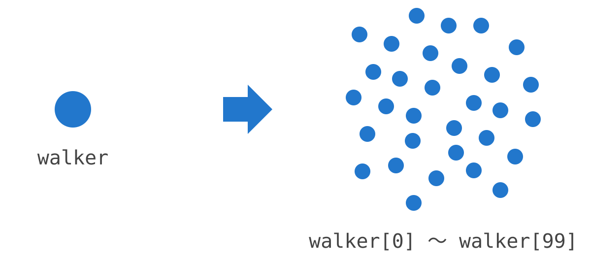

---

## クラスを作る

- walkerの配列へ (setup())

```javascript
const num = 10;
let walker = [];
function setup() {
  //初期設定
  createCanvas(windowWidth, windowHeight);
  //Walkerクラスをインスタンス化
  for (let i = 0; i < num; i++) {
    walker[i] = new Walker();
  }
  //軌跡を残す
  background(0);
}
```

---

## クラスを作る

- walkerの配列へ (draw())

```javascript
function draw() {
  //Walkerクラスのdraw()を実行
  for (let i = 0; i < num; i++) {
    walker[i].draw();
  }
}
```

---

## クラスを作る

- 10個に増殖したランダムウォーク!! → [Link](https://openprocessing.org/sketch/611325)

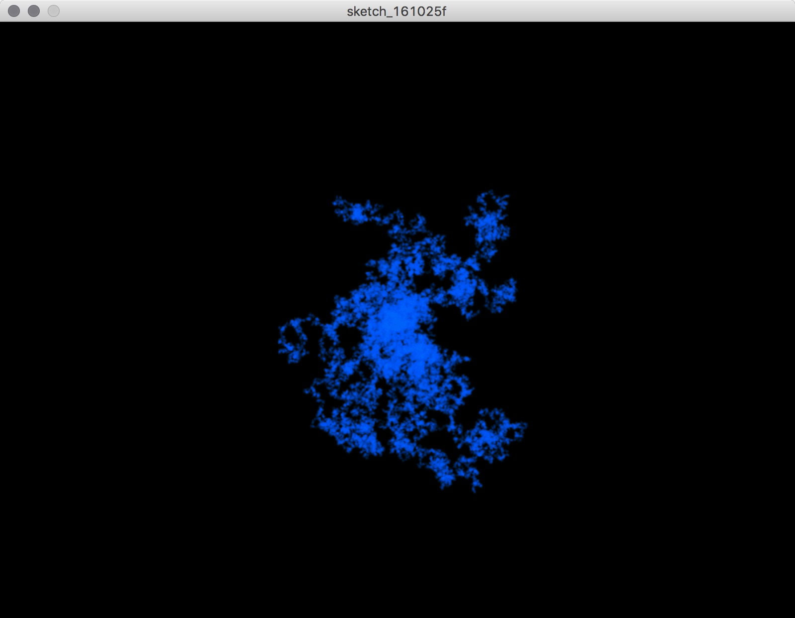

---

## クラスを作る

- 基本の構造さえつくってしまえば、Walkerはいくらでも増やせる!!
- 10個 → 100個に増やしてみる!!

---

## クラスを作る

- 100個のWalker!! (setup())

```javascript
const num = 100;
let walker = [];
function setup() {
  //初期設定
  createCanvas(windowWidth, windowHeight);
  //Walkerクラスをインスタンス化
  for (let i = 0; i < num; i++) {
    walker[i] = new Walker();
  }
  background(0);
}
```

---

## クラスを作る

- 100個のWalker!! (draw())

```javascript
function draw() {
  //画面をフェード
  blendMode(BLEND);
  fill(0, 5);
  rect(0, 0, width, height);
  //Walkerクラスのdraw()を実行 (色を加算して重ねる)
  blendMode(ADD);
  for (let i = 0; i < num; i++) {
    walker[i].draw();
  }
}
```

---

## クラスを作る

- 大量のランダムウォーカー → [Link](https://openprocessing.org/sketch/611326)

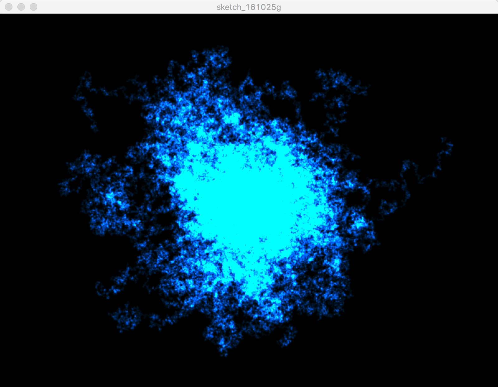

---

<!-- _class: bigtxt -->

# 参考資料: 生成的な形態を作る

---

## 生成的な形態を作る

- 生成的な形を描いてみる
  - 生成的 (Generative) - 数学的、機械的、あるいは無作為な過程によって自律的に生成されること

---

## 生成的な表現を利用した作品例

- Gallery of Computation, Jared Tarbell
- [http://www.complexification.net/gallery/](http://www.complexification.net/gallery/)

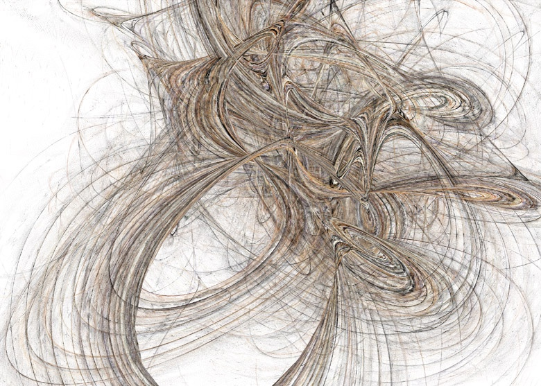

---

## 生成的な表現を利用した作品例

- Ambushes, Eno Henze
- [http://www.enohenze.de/](http://www.enohenze.de/)

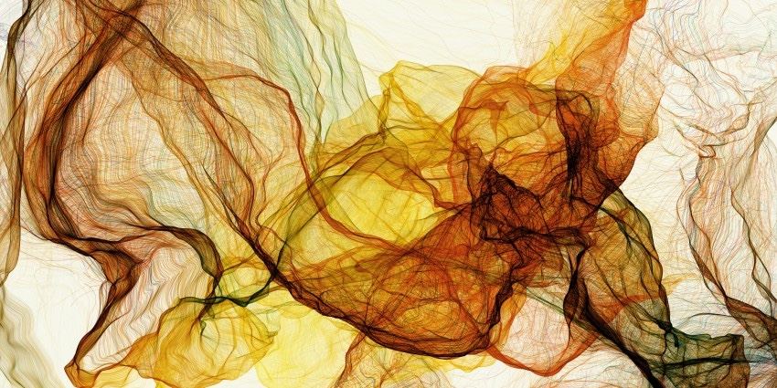

---

## 生成的な表現を利用した作品例

- Segmentation and Symptom, Golan Levin
- [http://www.flong.com/projects/zoo/](http://www.flong.com/projects/zoo/)

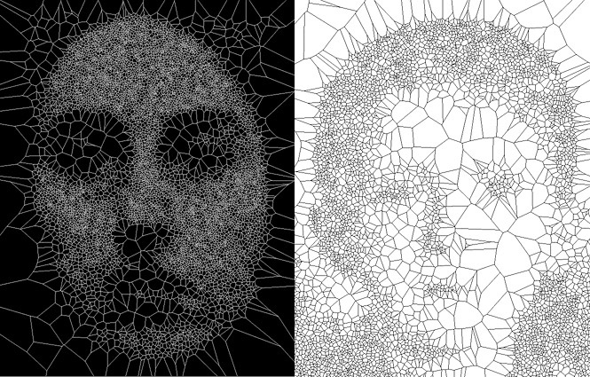

---

## 生成的な表現を利用した作品例

- Superformula, David Dessens
- [http://www.sanchtv.com/](http://www.sanchtv.com/)

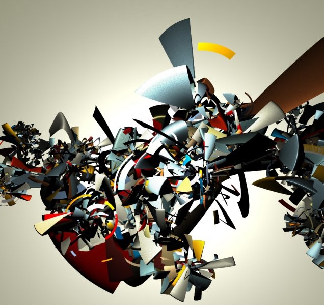

---

## 生成的な表現を利用した作品例

- Arcs 21, Lia
- [http://liaworks.com/projects/arcs21/](http://liaworks.com/projects/arcs21/)


---

## 生成的な表現を利用した作品例

- Process 1 - Process 18, Casey Reas
- [http://reas.com/texts/processdrawing-ad.html](http://reas.com/texts/processdrawing-ad.html)
- [http://vimeo.com/22955812](http://vimeo.com/22955812)

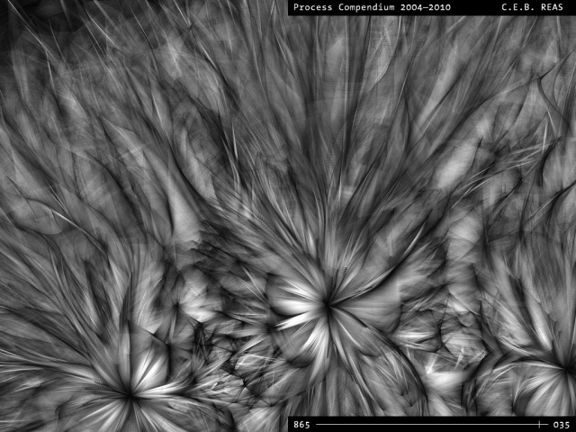

---

## 生成的な表現を利用した作品例

- Casey Reas “Process” のルール [http://reas.com/compendium_text/](http://reas.com/compendium_text/)
- Forms
  - F1: Circle
  - F2: Line
- Behaviors
  - B1: Move in a straight line
  - B2: Constrain to surface
  - B3: Change direction while touching another Element
  - B4: Move away from an overlapping Element
  - B5: Enter from the opposite edge after moving off the surface
  - B6: Orient toward the direction of an Element that is touching
  - B7: Deviate from the current direction

---

## 生成的な表現を利用した作品例

- Casey Reas “Process” のルール [http://reas.com/compendium_text/](http://reas.com/compendium_text/)
- Elements
  - E1: F1 + B1 + B2 + B3 + B4
  - E2: F1 + B1 + B5
  - E3: F2 + B1 + B3 + B5
  - E4: F1 + B1 + B2 + B3
  - E5: F2 + B1 + B5 + B6 + B7

---

## 生成的な表現をとりあつかった書籍

- Generative Gestaltung
- Hartmut Bohnacker, Benedikt Gross, Julia Laub, Claudius Lazzeroni (編集)
- [http://www.amazon.co.jp/dp/3874397599/](http://www.amazon.co.jp/dp/3874397599/)

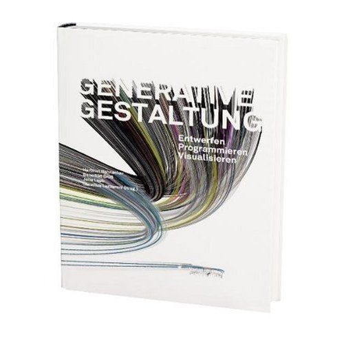

---

## 生成的な表現をとりあつかった書籍

- FORM+CODE -デザイン／アート／建築における、かたちとコード
- 久保田 晃弘 (監修), 吉村 マサテル (翻訳)
- [http://www.amazon.co.jp/dp/4861007518/](http://www.amazon.co.jp/dp/4861007518/)

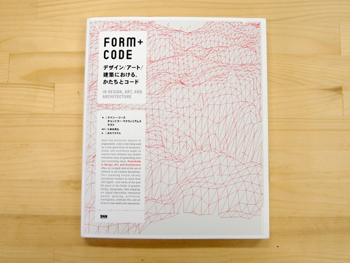

---

## 生成的な表現をとりあつかった書籍

- Generative Art: A Practical Guide Using Processing
- Matt Pearson (著)
- [http://www.amazon.co.jp/dp/1935182625/](http://www.amazon.co.jp/dp/1935182625/)

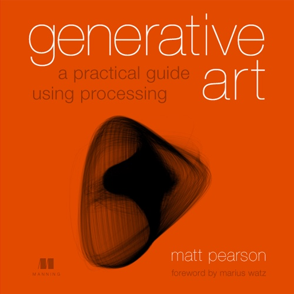

---

## 生成的な表現をとりあつかった書籍

- Visual Complexity: Mapping Patterns of Information
- Manuel Lima (著)
- [http://www.amazon.co.jp/dp/1568989369/](http://www.amazon.co.jp/dp/1568989369/)

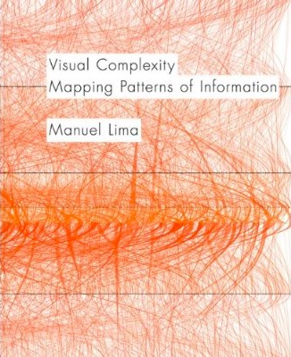

---

## 生成的な表現をとりあつかった書籍

- Written Images
- [http://writtenimages.net/](http://writtenimages.net/)

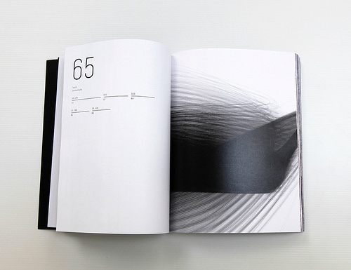

---

<!-- _class: bigtxt -->

# 本日の課題

---

## 本日の課題

- テーマ: 「クラスを用いてOOPな生成的な作品を制作する」
- 今回の講義内で作成した、増殖するランダムウォークのプログラムを参考に
  - オブジェクトを大量に複製することで、生成的な作品を制作する!
- OpenProcessingにタイトルをつけて投稿してください!
  - 作品の(かっこいい)タイトルをつけてください!!
  - 投稿したURLをアンケートから提出
  - TAGS: sfc261113 を必ずつけること
  - 前回の[提出作品](https://openprocessing.org/browse?q=sfc261106&time=anytime&type=tags&offset=0)で良いと思った作品を1つ選んでください
