今回は、前回に引き続き p5.js でのオブジェクト指向プログラミング (OOP) です。今回はクラスの「コンストラクター」に注目して、さらに掘り下げていきます。

まず始めに、前回学んだオブジェクト、プロパティー、メソッド、クラスについて簡単に復習します。次に、プヨプヨと伸縮しながら動きまわる物体のプログラムを、Puyopuyo クラスにまとめてみましょう。

そして、コンストラクターに引数を追加して、インスタンス化する際にパラメーターを渡せるようにします。1つのクラスから、大きさや位置、速度の異なる様々なバリエーションのオブジェクトを大量に生成してみましょう。最後に、マウスをクリックした場所から新たなオブジェクトが生まれる、インタラクティブな作品に発展させます。

## 本日の課題

テーマ: 「1つのクラスから、様々なバリエーションのオブジェクトを生成する」

今回学んだコンストラクターの引数を使って、1つのクラスから複数のオブジェクトを生成して表現してみましょう! クラスのコンストラクターの引数からパラメーターを読み込み、様々なバリエーションのオブジェクトが生成されるようにしてください。本日の Puyopuyo の例を参考にしてみてください。大きさや色、動きかたなどを引数で変えられるようにすると、同じクラスから生まれたとは思えないような多様な表情が生まれます。次回の授業の冒頭で簡単に作品をいくつか紹介します。

提出方法は以下の通りです。

- 完成した作品には、(かっこいい) タイトルをつける
- 完成した作品はOpenProcessingに投稿してURLを提出
- 必ず TAGS: [sfc261127](https://openprocessing.org/browse?q=sfc261127&time=anytime&type=tags&offset=0) を入れてください
- 前回の[提出作品](https://openprocessing.org/browse?q=sfc261113&time=anytime&type=tags&offset=0)で良いと思った作品を1つ選んでください
- 提出期限 12/03/2026

<!-- 提出フォームのURLを追加 -->
[課題提出フォーム](URL)

## スライド資料

<!-- スライド資料へのリンクを追加 -->
[スライド資料: p5.js オブジェクト指向プログラミング 2 - コンストラクターと、オブジェクトのバリエーション](URL)

## 今日の内容

- OOPについて (復習)
- 開始サンプル (非OOP)
- クラスにまとめる (OOP)
- オブジェクトのプロパティーを変更する
- コンストラクターの引数からパラメーターを渡す
- クラスから様々なバリエーションのオブジェクトを大量生成
- よりインタラクティブに!
- 実習

## OOPについて (復習)

### オブジェクト

まずは前回の内容を復習しましょう。プログラムの中の独立した機能の単位を「オブジェクト (Object)」と呼びます。

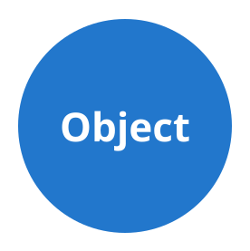

オブジェクトは、それぞれ自律していて、相互にメッセージを送りあいます。

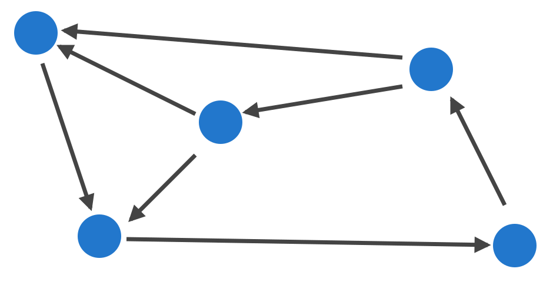

こうした、オブジェクトをプログラムの構成単位とするプログラム手法を、オブジェクト指向プログラミング (Object Oriented Programming : OOP) と呼びます。

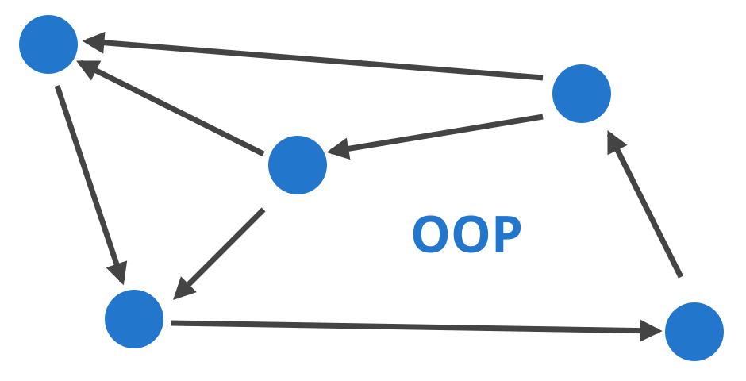

### プロパティーとメソッド

Object は、「状態 (プロパティー)」と「動作 (メソッド)」で特徴を記録します。

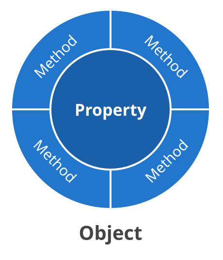

- 状態 → 値を記録する = 変数 (Variables)
- 動作 → 一連の処理をまとめる = 関数 (Functions)

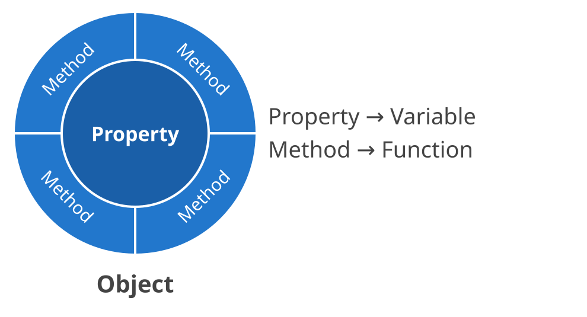

### クラス

OOPでは、オブジェクトの設計図をまず書きます。オブジェクトの設計図のことを「クラス (Class)」と呼びます。

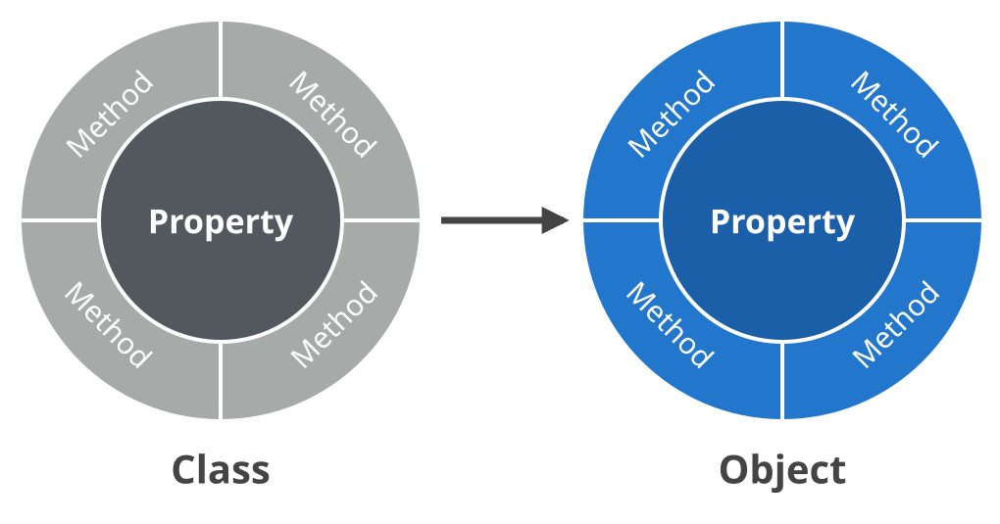

p5.js (JavaScript) のクラスの基本構造は以下のようになります。

```javascript
class MyClass {
  //コンストラクター
  constructor(value) {
    this.publicField = value;
  }
  //メソッドを宣言
  myFunction() {
    // ...
  }
  //他のメソッドを追加していく
  // ...
}
```

### コンストラクター

コンストラクター (constructor) とは、クラスが初期化される際に呼びだされる特別な関数です。関数名は constructor() です。今回は、このコンストラクターについて、さらに掘り下げていきます!

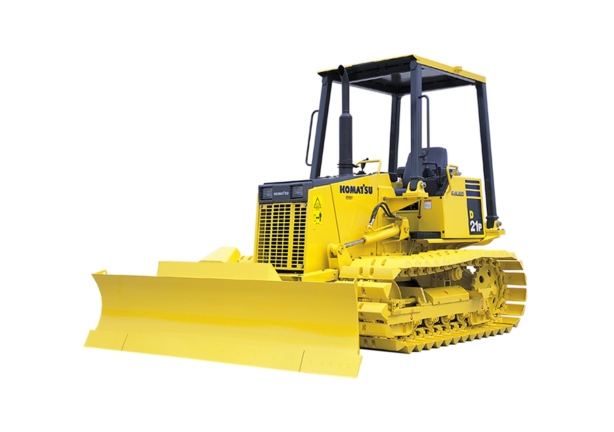

## 開始サンプル (非OOP)

### プヨプヨと動きまわる物体

今回は、以下のプログラムからスタートします。まだクラスを使っていない (非OOP) プログラムです。直径 (diameter)、位置 (position)、速度 (velocity) の3つの変数を使って、画面の壁でバウンドしながら動きまわる円を描いています。

- [開始サンプル](https://editor.p5js.org/tadokoro/sketches/XNJayEfYu)

```javascript
let diameter; //直径
let position; //位置
let velocity; //速度

function setup() {
  //初期設定
  createCanvas(windowWidth, windowHeight);
  diameter = 100.0;
  position = createVector(width / 2, height / 2);
  velocity = createVector(random(-2, 2), random(-2, 2));
}

function draw() {
  background(0);
  position.add(velocity); //位置を更新
  //壁でバウンド
  if (position.x < diameter / 2 || position.x > width - diameter / 2) {
    velocity.x *= -1;
  }
  if (position.y < diameter / 2 || position.y > height - diameter / 2) {
    velocity.y *= -1;
  }
  //色の設定
  noStroke();
  fill(255, 127);
  //プヨプヨする動きを計算
  let currentDiameter = sin(frameCount * 0.1) * (diameter / 4) + diameter;
  circle(position.x, position.y, currentDiameter); //周囲の円を描画
  fill(255);
  circle(position.x, position.y, diameter / 6.0); //核となる円を描画
}
```

周囲の円の直径を sin() で周期的に変化させることで、プヨプヨと伸縮しながら動きまわる物体になります。

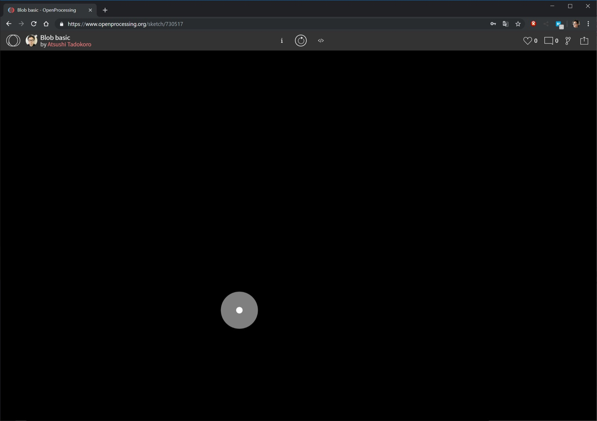

### draw() 内を関数に分けて整理

前々回に学んだ関数を使って、draw() の中の処理を機能ごとに整理してみましょう。移動 move()、壁でバウンド bounce()、表示 display() の3つの関数に分けます。

- [draw()内を関数に分けて機能を整理](https://editor.p5js.org/tadokoro/sketches/SEe6AR3Ur)

```javascript
let diameter; //直径
let position; //位置
let velocity; //速度

function setup() {
  createCanvas(windowWidth, windowHeight);
  diameter = 100.0;
  position = createVector(width / 2, height / 2);
  velocity = createVector(random(-2, 2), random(-2, 2));
}

function draw() {
  background(0);
  move(); //移動
  bounce(); //壁でバウンド
  display(); //表示
}

function move() {
  position.add(velocity);
}

function bounce() {
  if (position.x < diameter / 2 || position.x > width - diameter / 2) {
    velocity.x *= -1;
  }
  if (position.y < diameter / 2 || position.y > height - diameter / 2) {
    velocity.y *= -1;
  }
}

function display() {
  noStroke();
  fill(255, 127);
  let currentDiameter = sin(frameCount * 0.1) * (diameter / 4) + diameter;
  circle(position.x, position.y, currentDiameter);
  fill(255);
  circle(position.x, position.y, diameter / 6.0);
}
```

## クラスにまとめる (OOP)

### Puyopuyo クラスの設計

プヨプヨと動く物体 (Puyopuyo) をクラスにまとめてみましょう。Puyopuyo クラスのプロパティーとメソッドは以下のようになります。

- プロパティー (状態、変数)
  - 直径 (diameter)
  - 位置 (position)
  - 速度 (velocity)
- メソッド (動作、関数)
  - constructor() ※現状は setup()
  - move()
  - bounce()
  - display()

まず、Puyopuyo クラスの骨組を書いてみます。

```javascript
class Puyopuyo {
  constructor() {
    this.diameter;
    this.position;
    this.velocity;
  }

  move() {
  }

  bounce() {
  }

  display() {
  }
}
```

### メソッドを移植する

それぞれのメソッドに、本体のプログラムから処理を移植していきます。setup() で行っていた初期設定は、constructor() に移します。このとき、クラス全体で使用される変数には「this.」が先頭に追加されることに注意しましょう!!

- this.diameter
- this.position
- this.velocity

完成した Puyopuyo クラスは以下のようになります。

```javascript
class Puyopuyo {
  constructor() {
    this.diameter = 100.0;
    this.position = createVector(width / 2, height / 2);
    this.velocity = createVector(random(-2, 2), random(-2, 2));
  }

  move() {
    this.position.add(this.velocity);
  }

  bounce() {
    if (this.position.x < this.diameter / 2
      || this.position.x > width - this.diameter / 2) {
      this.velocity.x *= -1;
    }
    if (this.position.y < this.diameter / 2
      || this.position.y > height - this.diameter / 2) {
      this.velocity.y *= -1;
    }
  }

  display() {
    noStroke();
    fill(255, 127);
    let currentDiameter = sin(frameCount * 0.1) * (this.diameter / 4) + this.diameter;
    circle(this.position.x, this.position.y, currentDiameter);
    fill(255);
    circle(this.position.x, this.position.y, this.diameter / 6.0);
  }
}
```

### Puyopuyo クラスを呼び出す

作成した Puyopuyo クラスをインスタンス化 (実体化) して、動かしてみましょう。new Puyopuyo() でオブジェクトを作り、draw() の中からメソッドを実行します。以下のコードの下に、上の Puyopuyo クラスを書いてください。

- [オブジェクト版のPuyopuyo](https://openprocessing.org/sketch/730520)

```javascript
let puyopuyo;

function setup() {
  createCanvas(windowWidth, windowHeight);
  puyopuyo = new Puyopuyo(); //インスタンス化
}

function draw() {
  background(0);
  //Puyopuyoクラスのメソッドを実行
  puyopuyo.move();
  puyopuyo.bounce();
  puyopuyo.display();
}
```

オブジェクト版の Puyopuyo が動きました! 見た目は非OOP版と同じですが、プログラムの構造が整理されています。


## オブジェクトのプロパティーを変更する

クラスをインスタンス化 (初期化) した後で、プロパティーを変更することも可能です。やってみましょう! オブジェクト名の後に「.」をつけて、puyopuyo.diameter のようにプロパティーを指定して値を代入します。

```javascript
let puyopuyo;

function setup() {
  createCanvas(windowWidth, windowHeight);
  puyopuyo = new Puyopuyo();
  puyopuyo.diameter = 300; //サイズを変更
  puyopuyo.velocity = createVector(10, 15); //速度を変更
}

function draw() {
  background(0);
  puyopuyo.move();
  puyopuyo.bounce();
  puyopuyo.display();
}
```

大きさと速度が変化しました。

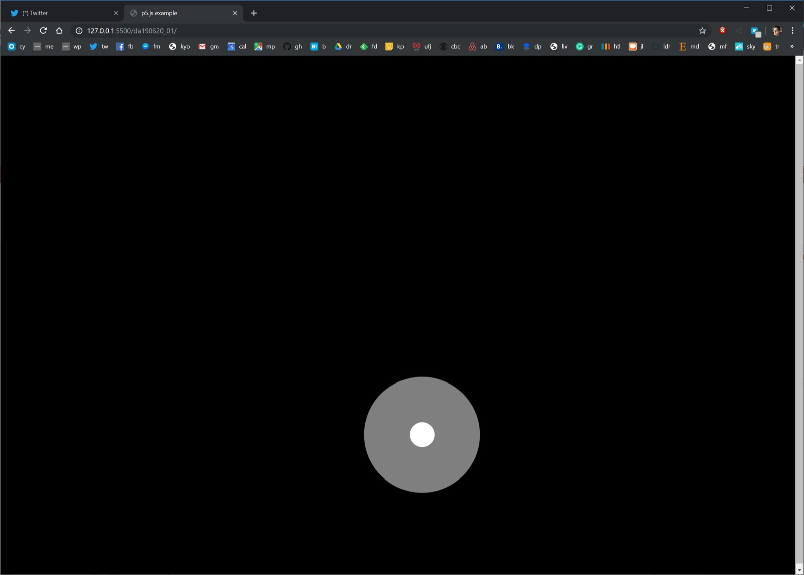

## コンストラクターの引数からパラメーターを渡す

### インスタンス化のタイミングでパラメーターを設定

クラスがインスタンス化するタイミングで、パラメーターを設定することも可能です。クラスをインスタンス化してからプロパティーを指定するのではなく、クラスのコンストラクターの引数として指定します。前々回に学んだ関数の引数と同じ考え方です。

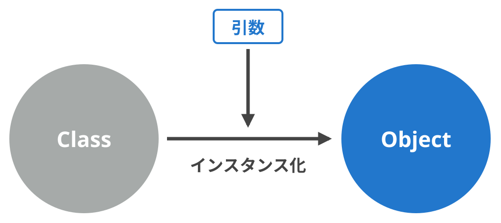

コンストラクターで値を受けとれるようにするには、以下のようにします。

- コンストラクターの定義に引数を追加
- 受け取った値を、クラス全体の変数 (this.xxx) に適用する

### constructor() に引数を追加

Puyopuyo クラスの constructor() に、直径 (diameter)、位置 (position)、速度 (velocity) の3つの引数を追加します。受け取った値を、this.diameter、this.position、this.velocity に代入します。move()、bounce()、display() はそのままです。

```javascript
class Puyopuyo {
  //コンストラクター
  constructor(diameter, position, velocity) {
    this.diameter = diameter;
    this.position = position;
    this.velocity = velocity;
  }

  ...(後略)...
```

### 引数を指定してインスタンス化

インスタンス化の際に、値を引数として受け渡します。new Puyopuyo() の () の中に、直径、位置、速度の順番で値を指定します。

```javascript
let puyopuyo;

function setup() {
  createCanvas(windowWidth, windowHeight);
  puyopuyo = new Puyopuyo(100, createVector(200, 200), createVector(-10, 5));
}

...(後略)...
```

インスタンス化で指定したパラメーターで、オブジェクトが生成されました。


## クラスから様々なバリエーションのオブジェクトを大量生成

### クラスは工場のようなもの

クラスは工場のようなものです。1つの工場をつくってしまえば、大量の車を次々と生産できます。さらに、コンストラクターに引数をつけることで、生産する車のバリエーションも増やせます!!

Puyopuyo クラスで試してみましょう! オブジェクトの配列を用意して、for文でくりかえし new Puyopuyo() を実行します。引数の値をランダムにすることで、1つのクラスから様々なパラメーターを適用したオブジェクトを生成します。配列の最後に要素を追加するには push() を使います。

- [様々なバージョンのPuyopuyo](https://openprocessing.org/sketch/730534)

```javascript
let puyopuyo = [];
const NUM = 100;

function setup() {
  //初期設定
  createCanvas(windowWidth, windowHeight);
  for (let i = 0; i < NUM; i++) {
    puyopuyo.push(
      new Puyopuyo(
        random(20, 80),
        createVector(random(width), random(height)),
        createVector(random(-2, 2), random(-2, 2))
      )
    );
  }
}

function draw() {
  //背景
  background(0);
  //ぷよぷよの表示と移動
  for (let i = 0; i < puyopuyo.length; i++) {
    puyopuyo[i].move();
    puyopuyo[i].bounce();
    puyopuyo[i].display();
  }
}
```

大きさも位置も速度も異なる、様々なバージョンの Puyopuyo が動き回ります!

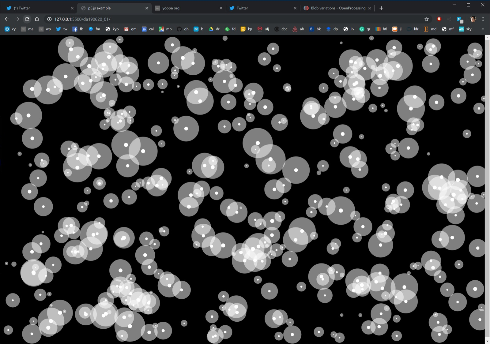

## よりインタラクティブに!

### クリックした場所から Puyopuyo を生成

ユーザーのアクションを取り込んでみましょう。例えば、ユーザーが画面上をクリックすると、マウスをクリックした場所から新たな Puyopuyo が生成されるようにしてみます。

mouseClicked() は、マウスがクリックされたときに呼び出される関数です。この中で、クリックした位置 (mouseX, mouseY) を引数にして新しい Puyopuyo を配列に追加します。draw() では puyopuyo.length (配列の要素の数) だけくりかえすので、オブジェクトが増えても同じプログラムのままで全て表示されます。

- [クリックした場所からPuyopuyoを生成](https://openprocessing.org/sketch/730539)

```javascript
let puyopuyo = []; //オブジェクトの配列

function setup() {
  createCanvas(windowWidth, windowHeight);
}

function draw() {
  background(0);
  //Puyopuyoクラスのメソッドを実行
  for (let i = 0; i < puyopuyo.length; i++) {
    puyopuyo[i].move();
    puyopuyo[i].bounce();
    puyopuyo[i].display();
  }
}

function mouseClicked() {
  //クリックした位置にぷよぷよを追加
  puyopuyo.push(
    new Puyopuyo(
      random(20, 80),
      createVector(mouseX, mouseY),
      createVector(random(-2, 2), random(-2, 2))
    )
  );
}
```

完成!! クリックするたびに Puyopuyo が増えていきます。


## 関連リンク

- [p5.js Web Editor](https://editor.p5js.org/)
- [p5.js リファレンス](https://p5js.org/reference/)
- [p5.js リファレンス: class](https://p5js.org/reference/p5/class/)
- [p5.js リファレンス: createVector()](https://p5js.org/reference/p5/createVector/)
- [p5.js リファレンス: p5.Vector](https://p5js.org/reference/p5/p5.Vector/)
- [p5.js リファレンス: sin()](https://p5js.org/reference/p5/sin/)
- [p5.js リファレンス: frameCount](https://p5js.org/reference/p5/frameCount/)
- [p5.js リファレンス: Array](https://p5js.org/reference/p5/Array/)
- [p5.js リファレンス: mouseClicked()](https://p5js.org/reference/p5/mouseClicked/)
- [MDN: クラス (JavaScript)](https://developer.mozilla.org/ja/docs/Web/JavaScript/Reference/Classes)
- [MDN: constructor](https://developer.mozilla.org/ja/docs/Web/JavaScript/Reference/Classes/constructor)
- [OpenProcessing](https://www.openprocessing.org/)

## 本日の課題

テーマ: 「1つのクラスから、様々なバリエーションのオブジェクトを生成する」

今回学んだコンストラクターの引数を使って、1つのクラスから複数のオブジェクトを生成して表現してみましょう! クラスのコンストラクターの引数からパラメーターを読み込み、様々なバリエーションのオブジェクトが生成されるようにしてください。本日の Puyopuyo の例を参考にしてみてください。大きさや色、動きかたなどを引数で変えられるようにすると、同じクラスから生まれたとは思えないような多様な表情が生まれます。次回の授業の冒頭で簡単に作品をいくつか紹介します。

提出方法は以下の通りです。

- 完成した作品には、(かっこいい) タイトルをつける
- 完成した作品はOpenProcessingに投稿してURLを提出
- 必ず TAGS: [sfc261127](https://openprocessing.org/browse?q=sfc261127&time=anytime&type=tags&offset=0) を入れてください
- 前回の[提出作品](https://openprocessing.org/browse?q=sfc261113&time=anytime&type=tags&offset=0)で良いと思った作品を1つ選んでください
- 提出期限 12/03/2026

<!-- 提出フォームのURLを追加 -->
[課題提出フォーム](URL)
