<style>
/* 図は左下詰め */
section:has(> p > img) {
  display: flex;
  flex-direction: column;
  justify-content: flex-start;
}
section p:has(> img) {
  margin-top: auto;
  margin-bottom: 0;
}
</style>

# デザインとプログラミング 2026<br>p5.js オブジェクト指向プログラミング 2<br>コンストラクターと、オブジェクトのバリエーション

慶應義塾大学環境情報学部
田所 淳

---

## 本日の内容

- p5.jsでOOP (オブジェクト指向プログラミング) その2
  - OOP復習
  - プロパティーを変化させる
  - コンストラクターと引数
  - インスタンス化で引数を渡して、オブジェクトにバリエーションをつける
  - オブジェクトとインタラクション

---

<!-- _class: bigtxt -->

# OOPについて (復習)

---

## OOPについて (復習)

- プログラムの中の独立した機能の単位 → 「オブジェクト（Object）」と呼ぶ

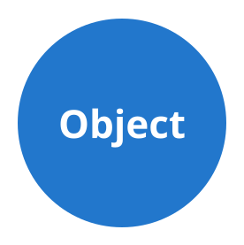

---

## OOPについて (復習)

- オブジェクトは、それぞれ自律していて、相互にメッセージを送りあう

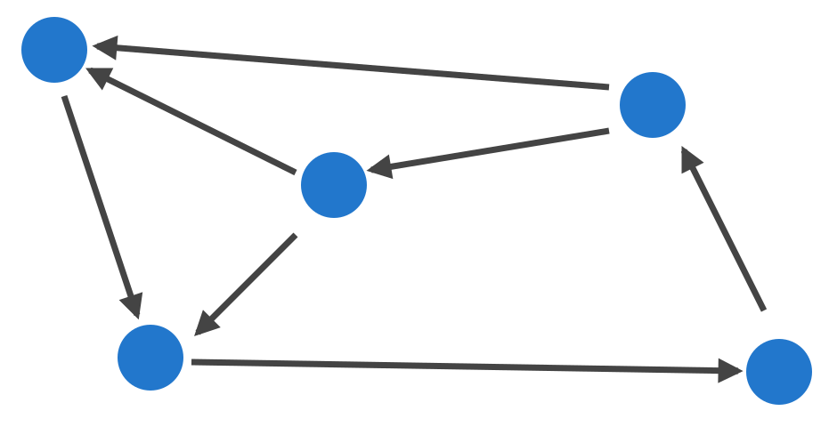

---

## OOPについて (復習)

- こうした、オブジェクトをプログラムの構成単位とするプログラム手法
- → オブジェクト指向プログラミング（Object Oriented Programming）と呼ぶ

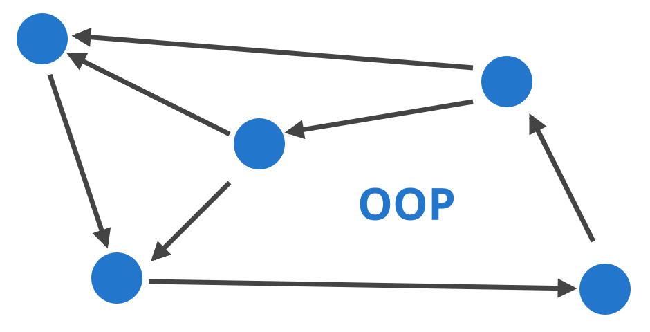

---

## OOPについて (復習)

- OOPを構成する単位「Object」に注目
- Objectは、「状態（プロパティー）」と「動作（メソッド）」で特徴を記録する

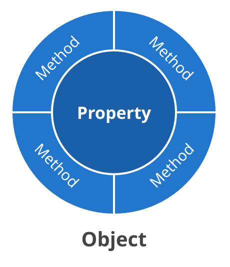

---

## OOPについて (復習)

- 状態 → 値を記録する = 変数（Variables）
- 動作 → 一連の処理をまとめる = 関数（Functions）

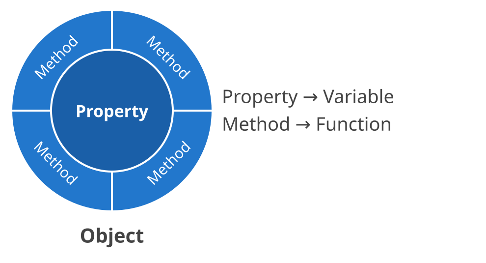

---

## OOPについて (復習)

- OOPでは、オブジェクトの設計図をまず書く
- オブジェクトの設計図のことをクラス（Class）と呼ぶ

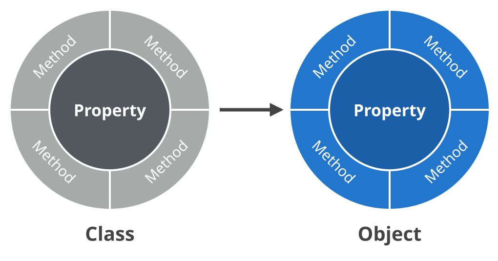

---

## OOPについて (復習)

- p5.js (JavaScript) のクラスの基本構造

```javascript
class MyClass {
  //コンストラクター
  constructor(value) {
    this.publicField = value;
  }
  //メソッドを宣言
  myFunction() {
    // ...
  }
  //他のメソッドを追加していく
  // ...
}
```

---

## OOPについて (復習)

- コンストラクター（constructor）とは?
- クラスが初期化される際に呼びだされる特別な関数
- 関数名は、constructor()

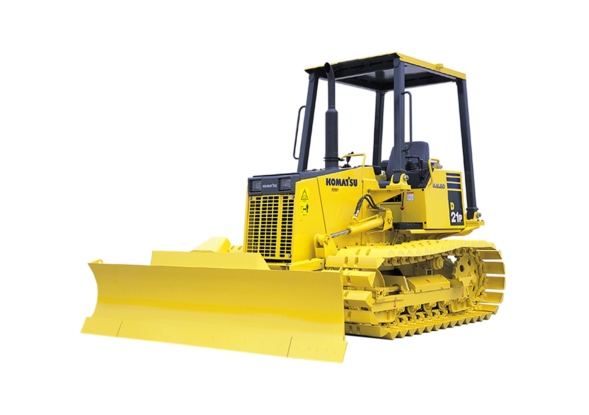

---

## OOPについて (復習)

- 今回は、このコンストラクターについて、さらに掘り下げていきます!


---

<!-- _class: bigtxt -->

# 開始サンプル (非OOP)

---

## 開始サンプル (非OOP)

- まず、ここからスタート → [Link](https://editor.p5js.org/tadokoro/sketches/XNJayEfYu)

```javascript
let diameter; //直径
let position; //位置
let velocity; //速度

function setup() {
  //初期設定
  createCanvas(windowWidth, windowHeight);
  diameter = 100.0;
  position = createVector(width / 2, height / 2);
  velocity = createVector(random(-2, 2), random(-2, 2));
}
```

---

## 開始サンプル (非OOP)

- draw() (1/2)

```javascript
function draw() {
  background(0);
  position.add(velocity); //位置を更新
  //壁でバウンド
  if (position.x < diameter / 2 || position.x > width - diameter / 2) {
    velocity.x *= -1;
  }
  if (position.y < diameter / 2 || position.y > height - diameter / 2) {
    velocity.y *= -1;
  }
```

---

## 開始サンプル (非OOP)

- draw() (2/2)

```javascript
  //色の設定
  noStroke();
  fill(255, 127);
  //プヨプヨする動きを計算
  let currentDiameter = sin(frameCount * 0.1) * (diameter / 4) + diameter;
  circle(position.x, position.y, currentDiameter); //周囲の円を描画
  fill(255);
  circle(position.x, position.y, diameter / 6.0); //核となる円を描画
}
```

---

## 開始サンプル (非OOP)

- プヨプヨと伸縮しながら動きまわる物体

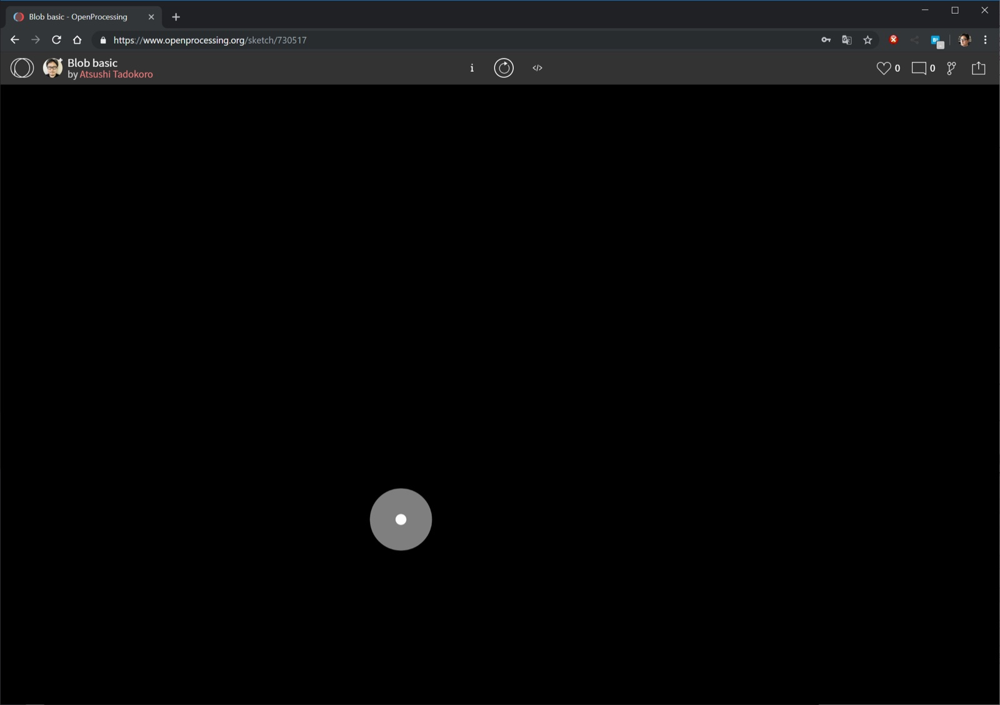

---

## 開始サンプル (非OOP)

- draw()内を関数に分けて機能を整理 → [Link](https://editor.p5js.org/tadokoro/sketches/SEe6AR3Ur)

```javascript
let diameter; //直径
let position; //位置
let velocity; //速度

function setup() {
  createCanvas(windowWidth, windowHeight);
  diameter = 100.0;
  position = createVector(width / 2, height / 2);
  velocity = createVector(random(-2, 2), random(-2, 2));
}

function draw() {
  background(0);
  move(); //移動
  bounce(); //壁でバウンド
  display(); //表示
}
```

---

## 開始サンプル (非OOP)

- draw()内を関数に分けて機能を整理 - move(), bounce()

```javascript
function move() {
  position.add(velocity);
}

function bounce() {
  if (position.x < diameter / 2 || position.x > width - diameter / 2) {
    velocity.x *= -1;
  }
  if (position.y < diameter / 2 || position.y > height - diameter / 2) {
    velocity.y *= -1;
  }
}
```

---

## 開始サンプル (非OOP)

- draw()内を関数に分けて機能を整理 - display()

```javascript
function display() {
  noStroke();
  fill(255, 127);
  let currentDiameter = sin(frameCount * 0.1) * (diameter / 4) + diameter;
  circle(position.x, position.y, currentDiameter);
  fill(255);
  circle(position.x, position.y, diameter / 6.0);
}
```

---

<!-- _class: bigtxt -->

# クラスにまとめる (OOP)

---

## クラスにまとめる (OOP)

- プヨプヨと動く物体 (Puyopuyo) をクラスにまとめる → Puyopuyoクラス
- プロパティー (状態、変数)
  - 直径 (diameter)
  - 位置 (position)
  - 速度 (velocity)
- メソッド (動作、関数)
  - constructor() ※現状は setup()
  - move()
  - bounce()
  - display()

---

## クラスにまとめる (OOP)

- まずPuyopuyoクラスの骨組を書いてみる

```javascript
class Puyopuyo {
  constructor() {
    this.diameter;
    this.position;
    this.velocity;
  }

  move() {
  }

  bounce() {
  }

  display() {
  }
}
```

---

## クラスにまとめる (OOP)

- それぞれのメソッドを本体から移植していく
  - constructor() ※現状は setup()
  - move()
  - bounce()
  - display()
- クラス全体で使用される変数には **this.** が先頭に追加されることに注意!!
  - this.diameter
  - this.position
  - this.velocity

---

## クラスにまとめる (OOP)

- Puyopuyoクラス (1/3)

```javascript
class Puyopuyo {
  constructor() {
    this.diameter = 100.0;
    this.position = createVector(width / 2, height / 2);
    this.velocity = createVector(random(-2, 2), random(-2, 2));
  }

  move() {
    this.position.add(this.velocity);
  }
```

---

## クラスにまとめる (OOP)

- Puyopuyoクラス (2/3)

```javascript
  bounce() {
    if (this.position.x < this.diameter / 2
      || this.position.x > width - this.diameter / 2) {
      this.velocity.x *= -1;
    }
    if (this.position.y < this.diameter / 2
      || this.position.y > height - this.diameter / 2) {
      this.velocity.y *= -1;
    }
  }
```

---

## クラスにまとめる (OOP)

- Puyopuyoクラス (3/3)

```javascript
  display() {
    noStroke();
    fill(255, 127);
    let currentDiameter = sin(frameCount * 0.1) * (this.diameter / 4) + this.diameter;
    circle(this.position.x, this.position.y, currentDiameter);
    fill(255);
    circle(this.position.x, this.position.y, this.diameter / 6.0);
  }
}
```

---

## クラスにまとめる (OOP)

- 作成したPuyopuyoクラスをインスタンス化 (実体化) して、動かしてみる

---

## クラスにまとめる (OOP)

- Puyopuyoクラスを呼び出す

```javascript
let puyopuyo;

function setup() {
  createCanvas(windowWidth, windowHeight);
  puyopuyo = new Puyopuyo(); //インスタンス化
}

function draw() {
  background(0);
  //Puyopuyoクラスのメソッドを実行
  puyopuyo.move();
  puyopuyo.bounce();
  puyopuyo.display();
}
```

---

## クラスにまとめる (OOP)

- オブジェクト版のPuyopuyoが動いた → [Link](https://openprocessing.org/sketch/730520)


---

<!-- _class: bigtxt -->

# オブジェクトのプロパティーを変更する

---

## オブジェクトのプロパティーを変更する

- クラスをインスタンス化 (初期化) した後で、プロパティーを変更することも可能
- やってみよう!

---

## オブジェクトのプロパティーを変更する

- インスタンス化した後でプロパティーを変更

```javascript
let puyopuyo;

function setup() {
  createCanvas(windowWidth, windowHeight);
  puyopuyo = new Puyopuyo();
  puyopuyo.diameter = 300; //サイズを変更
  puyopuyo.velocity = createVector(10, 15); //速度を変更
}

function draw() {
  background(0);
  puyopuyo.move();
  puyopuyo.bounce();
  puyopuyo.display();
}
```

---

## オブジェクトのプロパティーを変更する

- 大きさと速度が変化した

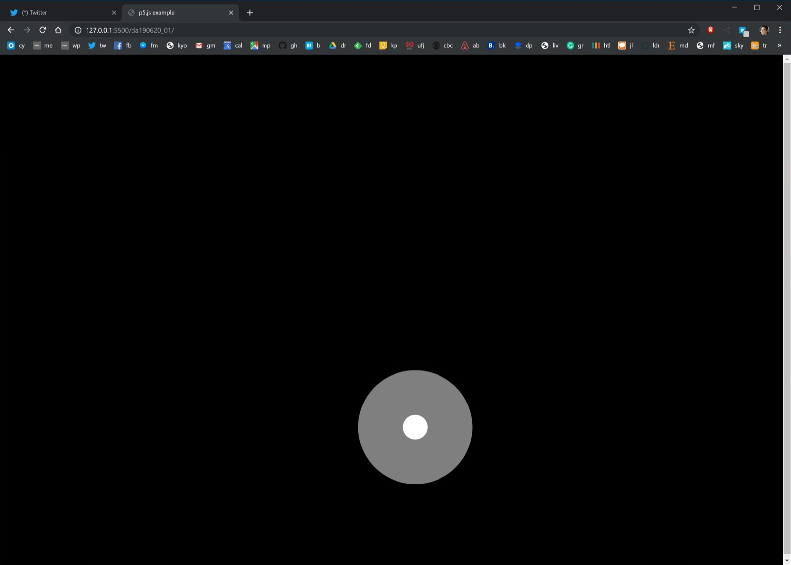

---

<!-- _class: bigtxt -->

# コンストラクターの引数からパラメーターを渡す

---

## コンストラクターの引数からパラメーターを渡す

- クラスがインスタンス化するタイミングでパラメーターを設定することが可能
  - クラスをインスタンス化してからプロパティーを指定するのではない
  - クラスのコンストラクターの引数として指定する

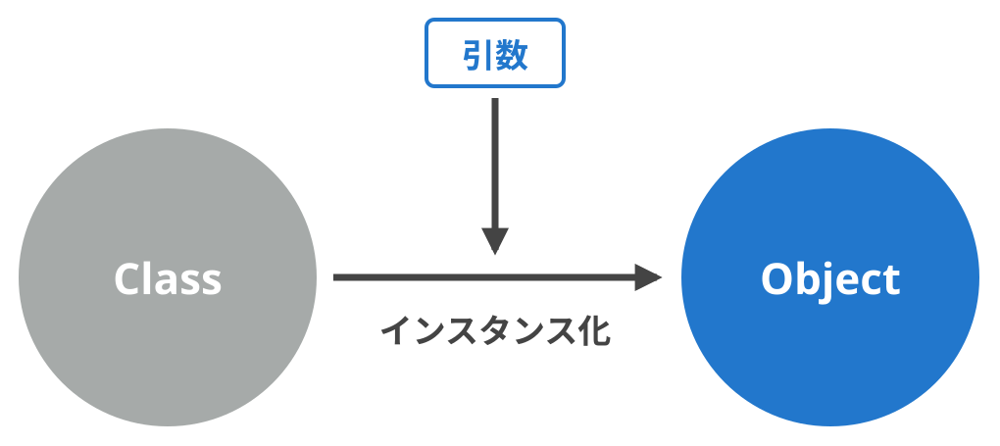

---

## コンストラクターの引数からパラメーターを渡す

- コンストラクターで値を受けとれるようにするには
  - コンストラクターの定義に引数を追加
  - 受け取った値を、クラス全体の変数 (this.xxx) に適用する

---

## コンストラクターの引数からパラメーターを渡す

- Puyopuyoクラスのconstructor()に引数を追加

```javascript
class Puyopuyo {
  //コンストラクター
  constructor(diameter, position, velocity) {
    this.diameter = diameter;
    this.position = position;
    this.velocity = velocity;
  }

  ...(後略)...
```

---

## コンストラクターの引数からパラメーターを渡す

- インスタンス化の際に値を引数として受け渡す

---

## コンストラクターの引数からパラメーターを渡す

- 引数を指定してインスタンス化

```javascript
let puyopuyo;

function setup() {
  createCanvas(windowWidth, windowHeight);
  puyopuyo = new Puyopuyo(100, createVector(200, 200), createVector(-10, 5));
}

...(後略)...
```

---

## コンストラクターの引数からパラメーターを渡す

- インスタンス化で指定したパラメーターでオブジェクトが生成された


---

<!-- _class: bigtxt -->

# クラスから様々なバリエーションの<br>オブジェクトを大量生成

---

## クラスから様々なバリエーションのオブジェクトを大量生成

- クラスは工場のようなもの
  - 1つの工場をつくってしまえば、大量の車を次々と生産できる
  - コンストラクターに引数をつけることで、生産する車のバリエーションも増やせる!!
- Puyopuyoクラスで試してみる!

---

## クラスから様々なバリエーションのオブジェクトを大量生成

- 1つのクラスから様々なパラメーターを適用したオブジェクトを生成 (setup())

```javascript
let puyopuyo = [];
const NUM = 100;

function setup() {
  //初期設定
  createCanvas(windowWidth, windowHeight);
  for (let i = 0; i < NUM; i++) {
    puyopuyo.push(
      new Puyopuyo(
        random(20, 80),
        createVector(random(width), random(height)),
        createVector(random(-2, 2), random(-2, 2))
      )
    );
  }
}
```

---

## クラスから様々なバリエーションのオブジェクトを大量生成

- 1つのクラスから様々なパラメーターを適用したオブジェクトを生成 (draw())

```javascript
function draw() {
  //背景
  background(0);
  //ぷよぷよの表示と移動
  for (let i = 0; i < puyopuyo.length; i++) {
    puyopuyo[i].move();
    puyopuyo[i].bounce();
    puyopuyo[i].display();
  }
}
```

---

## クラスから様々なバリエーションのオブジェクトを大量生成

- 様々なバージョンのPuyopuyoが動き回る! → [Link](https://openprocessing.org/sketch/730534)

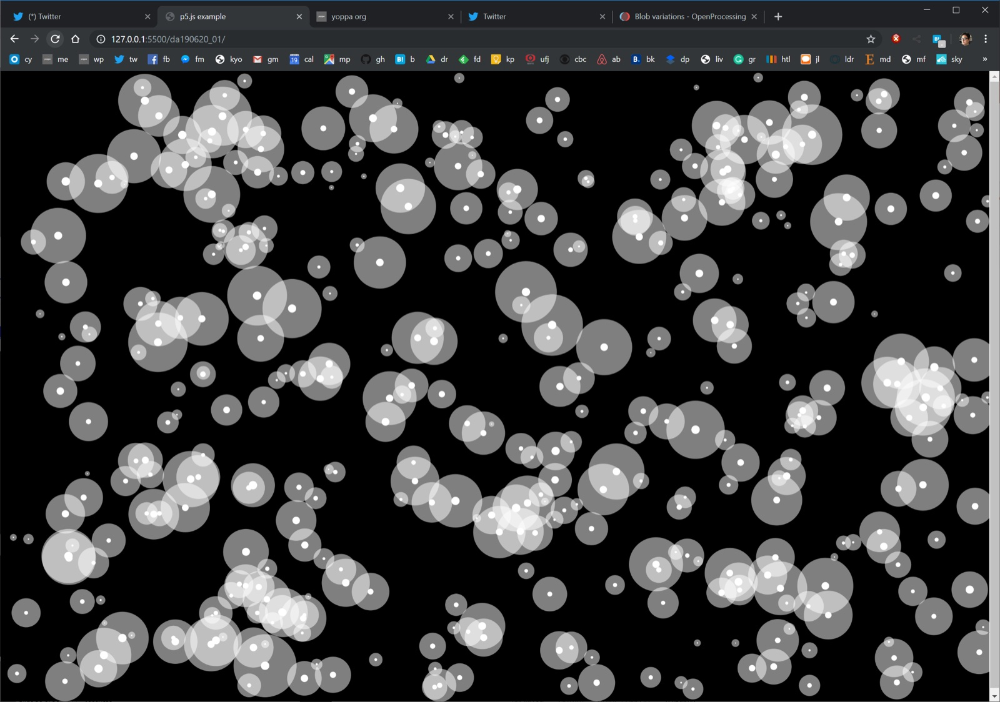

---

<!-- _class: bigtxt -->

# よりインタラクティブに!

---

## よりインタラクティブに!

- ユーザーのアクションを取り込んでみる
- 例えば…
  - ユーザーが画面上をクリックすると、新たなPuyopuyoが生成される
  - マウスをクリックした場所から生成される
- やってみよう!

---

## よりインタラクティブに!

- クリックした場所からPuyopuyoを生成 (setup(), draw())

```javascript
let puyopuyo = []; //オブジェクトの配列

function setup() {
  createCanvas(windowWidth, windowHeight);
}

function draw() {
  background(0);
  //Puyopuyoクラスのメソッドを実行
  for (let i = 0; i < puyopuyo.length; i++) {
    puyopuyo[i].move();
    puyopuyo[i].bounce();
    puyopuyo[i].display();
  }
}
```

---

## よりインタラクティブに!

- クリックした場所からPuyopuyoを生成 (mouseClicked())

```javascript
function mouseClicked() {
  //クリックした位置にぷよぷよを追加
  puyopuyo.push(
    new Puyopuyo(
      random(20, 80),
      createVector(mouseX, mouseY),
      createVector(random(-2, 2), random(-2, 2))
    )
  );
}
```

---

## よりインタラクティブに!

- 完成!! → [Link](https://openprocessing.org/sketch/730539)


---

<!-- _class: bigtxt -->

# 本日の課題

---

## 本日の課題

- テーマ: 「1つのクラスから、様々なバリエーションのオブジェクトを生成する」
- 1つのクラスから複数のオブジェクトを生成して表現してください
  - クラスのコンストラクターの引数からパラメーターを読み込み
  - 様々なバリエーションのオブジェクトが生成されるように
  - 本日のPuyopuyoの例を参考にしてみてください!
- OpenProcessingにタイトルをつけて投稿してください!
  - 作品の(かっこいい)タイトルをつけてください!!
  - 投稿したURLをアンケートから提出
  - TAGS: sfc261127 を必ずつけること
  - 前回の[提出作品](https://openprocessing.org/browse?q=sfc261113&time=anytime&type=tags&offset=0)で良いと思った作品を1つ選んでください
