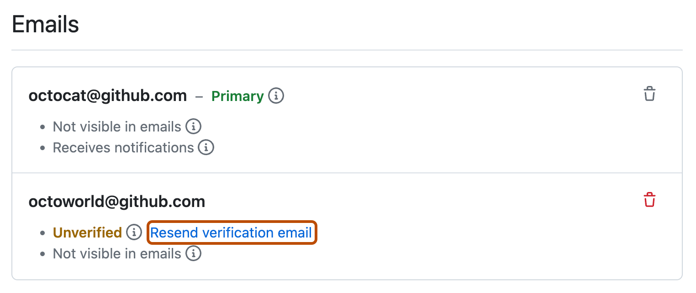
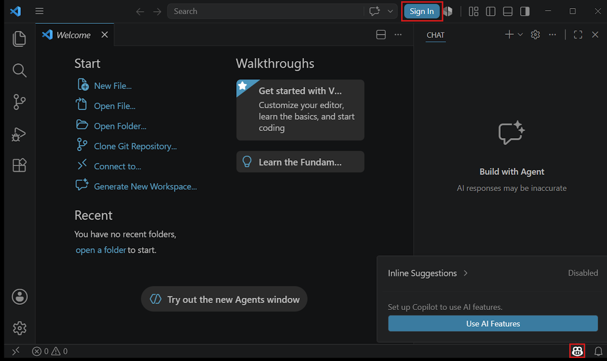
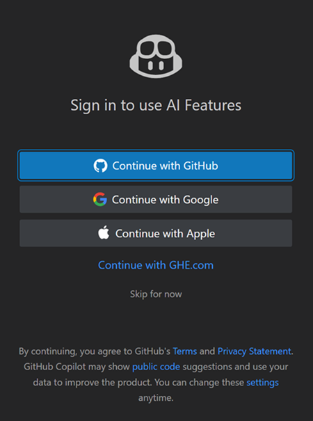
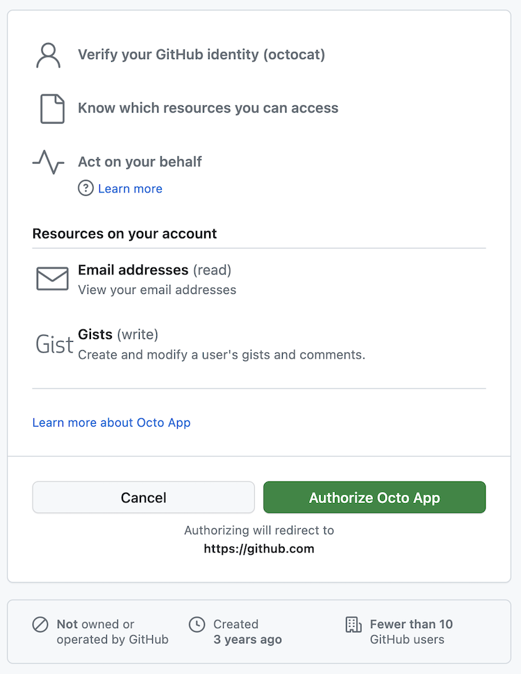
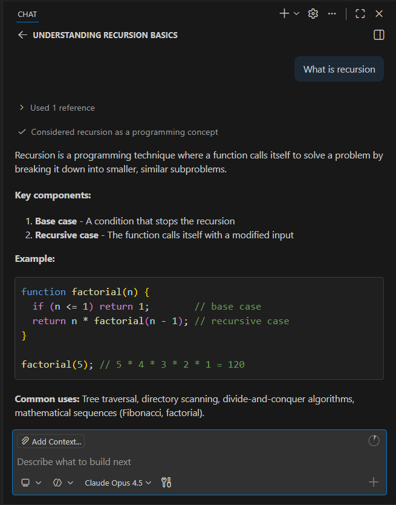
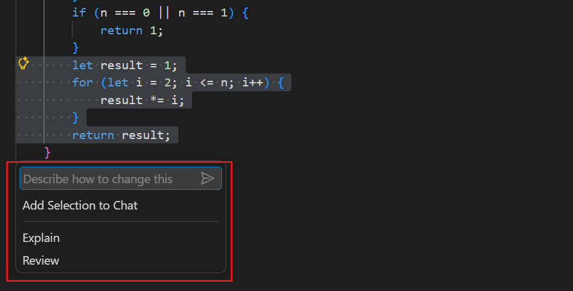
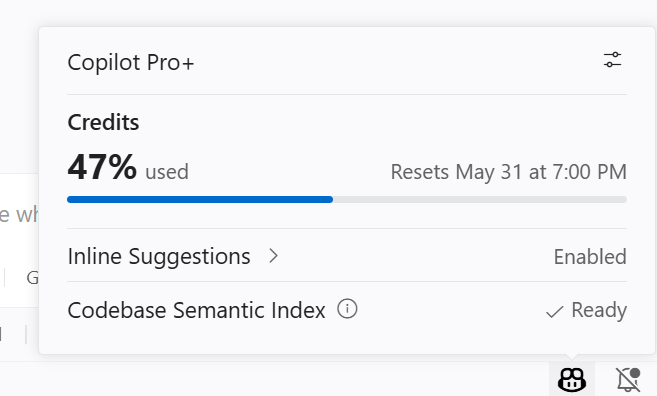
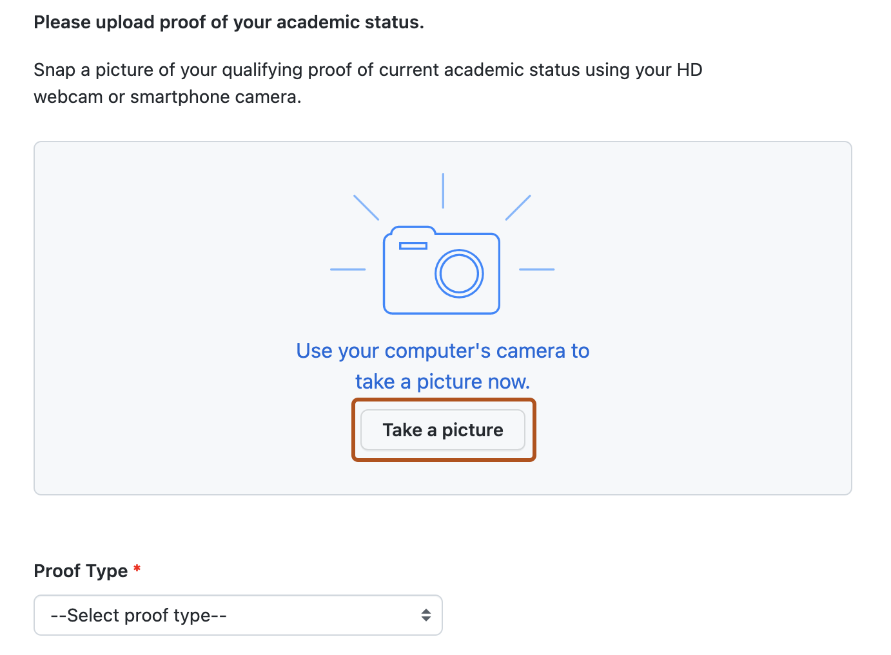
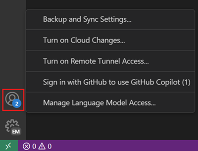

# AI支援プログラミング環境の構築 Visual Studio Code と GitHub Copilot のセットアップ

---

## このスライド資料で行うこと

- **開発環境の準備**: VS Code と GitHub Copilot のセットアップ手順
- **AI 支援プログラミングの基本を体験**:
  - **コード補完**: 書きかけのコードの続きを AI がリアルタイム提案
  - **チャット相談**: コードの書き方やエラーの原因を日本語で質問
  - **インライン編集**: 選択したコードをその場で直接リファクタリング

> 💡 **拡張機能のインストールは不要**（VS Code 1.116 以降は本体に Copilot が標準搭載）。GitHub アカウントでサインインするだけですぐに使い始められます。

---

## 全体の流れ

1. **VS Code をインストール**（エディタの導入）
2. **GitHub アカウントを作成**（AI 機能の利用に必須）
3. **VS Code で AI 機能を有効化**（サインインの開始）
4. **GitHub でサインインして認可**（Copilot Free の自動登録）
5. **コード補完を試す**（ゴーストテキスト・Tab で確定）
6. **チャット機能を試す**（質問チャット & インライン編集）
7. **使用量の確認 & 学生特典**（無料枠と Copilot Student）

---

## 1. VS Code をインストール

- 公式サイトからダウンロード: https://code.visualstudio.com/

| OS | インストール手順 |
| :--- | :--- |
| **Windows** | ダウンロードしたインストーラを実行（設定はデフォルトのままで OK） |
| **macOS** | zip を展開し、`Visual Studio Code.app` を「アプリケーション」フォルダへ移動 |

> > ⚠️ **メニューの言語について**: 最初は英語で表示されます。本スライドでも世界共通で情報が探しやすい英語UI名（Settings, Accounts など）で説明します。

---

<!-- _footer: 画像出典:GitHub Docs(CC BY 4.0) -->

## 2. GitHub アカウントを作成

- https://github.com/ を開いて **Sign up**（Google アカウントでも登録可能）
- メールアドレス・パスワード・ユーザー名・国/地域を入力し、パズルを解く
- メールに届く確認コードを入力して **メール認証を完了**
  - 認証状態は `Settings > Emails` で確認可能（Unverified なら再送できる）

---

<!-- _footer: 画像出典:Visual Studio Code Docs(CC BY 3.0 US) -->

## 3. VS Code で AI 機能を有効にする

VS Code を起動し、次のどちらかをクリック（図の赤枠参照）:

- **方法 A（推奨）**: タイトルバー右上の **Sign In**
- **方法 B**: 右下ステータスバーの Copilot アイコン → **Use AI Features**

---

<!-- _footer: 画像出典:Visual Studio Code Docs(CC BY 3.0 US) -->

## 4-1. サインイン方法を選ぶ

- **Continue with GitHub** を選ぶ
- 自動でブラウザが開くので、手順2で作ったアカウントでログイン
- Copilot の契約がないアカウントは、自動的に **Copilot Free**（無料プラン）に登録される
  - クレジットカードの登録などは一切不要

---

<!-- _footer: 画像出典:GitHub Docs(CC BY 4.0) -->

## 4-2. ブラウザで認可する

- **認可を実行**:
  - VS Code からのアクセス許可画面が出たら、緑の **Authorize** ボタンを押す
  - （右は画面の例。実際はアプリ名が Visual Studio Code と表示されます）
- **エディタに戻る**:
  - 「Visual Studio Code を開きますか?」と聞かれたら許可して戻る
- **完了確認**:
  - 右下の Copilot アイコンを開き、プラン名（Copilot Free など）が表示されていれば完了！

---

<!-- _footer: 画像出典:Visual Studio Code Docs(CC BY 3.0 US) -->

## 5. コード補完を試す（Inline Suggestion）

- `File > New Text File` で新規ファイルを作り、`sketch.js` などの名前で保存
- 関数名やコメントを書くと、続きのコードが **薄いグレー（ゴーストテキスト）** で提案される

- <kbd>Tab</kbd>: **提案を確定** / <kbd>Esc</kbd>: **提案を破棄**
- 👉 **試してみよう**: `// 1から10までの合計をコンソールに表示する` と書いて改行

---

<!-- _footer: 画像出典:Visual Studio Code Docs(CC BY 3.0 US) -->

## 6-1. チャットで質問する（Chat View）

- **開き方**:
  - Windows: <kbd>Ctrl</kbd> + <kbd>Alt</kbd> + <kbd>I</kbd>
  - macOS: <kbd>⌃ Control</kbd> + <kbd>⌘ Command</kbd> + <kbd>I</kbd>
  - または上部の **Chat** メニュー → **Open Chat**
- **使い方**:
  - 画面右のチャット欄で日本語で質問
  - 例:「このコードの意味を分かりやすく解説して」
  - 例:「エラー `TypeError: undefined` の原因は？」

---

<!-- _footer: 画像出典:Visual Studio Code Docs(CC BY 3.0 US) -->

## 6-2. インラインチャットでコードを直す

エディタ上でコードから目を離さずに直接リファクタリングできます。

- **ショートカット**: Windows: <kbd>Ctrl</kbd> + <kbd>I</kbd> / macOS: <kbd>⌘ Command</kbd> + <kbd>I</kbd>
- **使い方**:
  1. 直したいコードを選択（未選択時はカーソル行が対象）
  2. ショートカットを押し、「for文を配列メソッドに書き換えて」などと指示して Enter
  3. 提案された差分を確認し、**Keep**（採用）または **Undo**（取り消し）を選択

---

<!-- _footer: 画像出典:Visual Studio Code Docs(CC BY 3.0 US) -->

## 7. 使用量を確認する

- 右下ステータスバーの Copilot アイコンをクリック
- 今月の利用枠を何%消費したかが表示される
  - （右は有料プランの例。Free ではコード補完の使用量も表示）
- **Copilot Free の月間上限**:
  - **コード補完**: 2,000回まで（確定ベース）
  - **チャット**: AIクレジットの範囲内（月50回程度が目安）
- 課題制作に入る前に、残り枠を確認しておきましょう

---

<!-- _footer: 画像出典:GitHub Docs(CC BY 4.0) -->

## 上限を気にせず使うには？

- **GitHub Student Developer Pack**:
  - 学生認証を行うと、有料相当の **Copilot Student** を **無料** で利用できます
- **申請・有効化の手順**:
  1. https://github.com/settings/education/benefits にアクセス
  2. 大学のメールアカウント (ac.jp) を登録し、学生証の写真等を提出して申請
  3. 認証完了後、同ページで Copilot Student を有効化
  - ※ 認証反映に数日かかる場合があります
- 詳細: [GitHub Docs「Copilot Student の設定」](https://docs.github.com/en/copilot/how-tos/copilot-on-github/set-up-copilot/enable-copilot/set-up-for-students)

---

## データの扱いとプライバシー設定

課題や研究で安心して利用するために、初期設定と変更方法を把握しておきましょう。

- **Copilot Free の初期設定**:
  - テレメトリ（製品改善のためのデータ送信）: **有効**
  - 公開コードと一致する提案（Public code suggestions）: **許可**
- **より厳格に変更したい場合**:
  - **VS Code 設定**: `telemetry.telemetryLevel` を検索して `off` に設定
  - **GitHub 設定**: 🔗 https://github.com/settings/copilot を開き、
    - 「Suggestions matching public code」を **Block** に変更
    - 「Allow GitHub to use my data for AI model training」を **Disabled** に変更

---

<!-- _footer: 画像出典:Visual Studio Code Docs(CC BY 3.0 US) -->

## トラブルシューティング（うまくいかないとき）

- **Sign In ボタンや Copilot アイコンが見当たらない**
  - 左下の人型アイコン（Accounts）→ **Sign in with GitHub to use GitHub Copilot**
  - VS Code のバージョンを確認（1.116 以降が必要。古ければアップデート）
- **別のアカウントでサインインしてしまった**
  - Accounts メニューから **Sign out** して正しいアカウントで入り直す
- **コード補完が出ない**
  - ファイルを拡張子付き（`sketch.js` など）で保存しているか確認

---

## まとめ

- **VS Code だけで完結**:
  - 拡張機能の追加不要で、AI コード補完とチャットが最初から利用可能
- **2 つの機能を日常的に活用**:
  - コード入力中のリアルタイム提案: **コード補完（Tab で確定）**
  - コードの相談・エラー解決: **チャット（Ctrl+Alt+I / ⌃⌘I）**
  - 部分的なコード書き換え: **インラインチャット（Ctrl+I / ⌘I）**
- **学生特典を活用しよう**:
  - まずは無料枠（Copilot Free）で試し、慣れてきたら **Copilot Student** を申請して制限なしで開発を進めましょう！